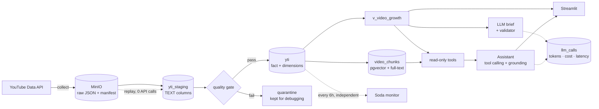
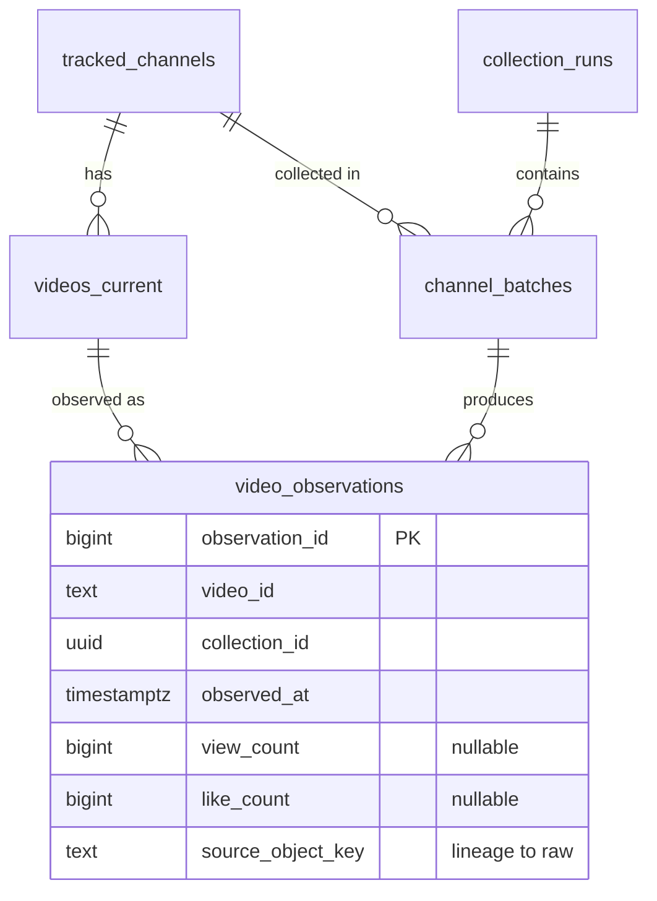

# YouTube Content Intelligence

An ELT pipeline that tracks view growth across a fixed set of YouTube channels, with
immutable raw storage, idempotent loads, a pre-publish quality gate, an LLM-written daily
brief that cannot invent numbers, and a Q&A assistant that answers through read-only tools
and has every number in its answer checked against those tools' results.

**Stack:** Airflow · PostgreSQL + pgvector · MinIO (S3-compatible) · Docker Compose · Soda ·
Streamlit · OpenAI (tool calling, embeddings)

| | |
|---|---|
| Channels tracked | 4 (2 groups: `books_learning`, `kids_animation`) |
| Scope | 50 most recent videos per channel (~200 videos), one snapshot per day |
| Quota per run | 12 units of YouTube's 10,000/day |
| Tests | 330 (301 unit, 7 DAG, 22 integration) |
| Brief prompt eval | v1 13/20 → v2 17/20 → **v3 20/20** on 20 synthetic cases |
| Assistant eval | 45 synthetic cases, 9 code-based scorers — *results pending, see `evals/results/`* |
| RAG eval | recall@5 / MRR@5, vector vs full-text vs hybrid — *pending human-labeled queries* |

---

## Architecture



Three Airflow DAGs, all thin wrappers around a CLI:

- **`yt_collect`** — daily at 21:00 (Asia/Ho_Chi_Minh), one task per channel in parallel. A final
  check task turns the run red if any channel fails; the Dataset event still fires for the rest.
- **`yt_report`** — runs when `yt_collect` publishes new observations (Airflow Dataset),
  not on a clock, so it never reads half-finished data.
- **`yt_quality`** — every 6 hours, **on its own schedule** so it still fires if collection stops.
- **`yt_embed`** — on the same Dataset as `yt_report`, but separate: embeds only new or changed
  titles/descriptions for search, and an embedding failure cannot block the brief.

---

## Design decisions

**Raw first, database second.** YouTube does not return historical statistics — a missed
day is gone for good. Raw responses are written to object storage before anything else,
with a manifest written last as a commit marker. Any bug in parsing can be fixed and
replayed from raw with zero API calls: `youtube-intel replay --collection-id <id>`.

**Grain is "one video per collection run", not "one video per day".** Keying on date
breaks as soon as collection runs twice a day. Each run gets a deterministic UUIDv5
derived from Airflow's logical date, so parallel tasks agree on it without coordination
and retries land on the same rows (`ON CONFLICT` upsert → idempotent).

**Block before publish, monitor after.** A Python quality gate checks each batch *before*
it reaches published tables; failing batches are quarantined, not deleted. Soda then
watches the published tables on an independent schedule — including a freshness check,
the one failure mode a per-batch gate structurally cannot see (no batch → no gate run).

**Unknown is not zero.** Hidden like counts stay `NULL`; the growth view labels videos it
cannot rank (`insufficient_history`, `window_too_short`, …) instead of scoring them 0.
Shorts are never inferred from duration alone — a 77-second video might not be a Short.

**The LLM writes prose; code writes facts.** Every number in the brief, and the scope
statement listing which channels it covers, is rendered by code. The validator rejects any
digit or URL in LLM prose, any `video_id` or observation id not in the evidence bundle, and
any reuse of a reference channel's character names in content suggestions. It falls back to
a deterministic template after one repair attempt, so the brief is never lost because an
external API failed.

**Prompts are versioned and evaluated, not eyeballed.** A deterministic eval harness runs
each prompt version over 20 fixed synthetic cases, each built to trigger one failure mode
(overstating weak videos, claiming to have watched a video, wrong scope, prompt injection
in titles, reusing character names). Results are stored with the full LLM output so the
scorers can be fixed and re-run without new API calls.

| Check | v1 | v2 | v3 |
|---|---|---|---|
| No claims about unwatched content | 16/20 | 20/20 | 20/20 |
| No hype on weak videos | 1/3 | 3/3 | 3/3 |
| Scope accurate | 19/20 | 20/20 | 20/20 |
| No reuse of reference names | 8/9 | **6/9** | 9/9 |
| **Cases passed** | 13/20 | 17/20 | **20/20** |

v2 fixed its three target issues but regressed on character names — caught only because the
harness scores every check, not just the ones being fixed. v3 is in production.

**Classified failures, recorded honestly.** API errors are split into quota exhausted /
misconfiguration / transient; only transient errors are retried. A failed channel is written to
`channel_batches` as `failed` in its own transaction (its main transaction has rolled back), and a
run's status is derived from its channel batches, so four parallel tasks agree on `partial` instead
of the last writer winning. The API key travels in a request header, so it can never appear in a
logged URL.

**The assistant picks tools; it never writes SQL.** Questions go through an agent loop where the
LLM may only call eight pre-written, parameterised, read-only tools (row limit, statement timeout,
a SELECT-only database login) and must finish with `submit_answer`. A pure-function grounding
validator then extracts every number (Vietnamese or English formatting, K/M/B, nghìn/triệu/tỷ, %),
date, time and video id from the answer and requires each to match a tool result of the same turn,
allowing only honest rounding. One repair round; if it still fails, the user gets a table built
straight from the tool results. Tool output, titles and descriptions are wrapped as data and tested
with injection cases.

**Hybrid retrieval over public metadata.** Titles and descriptions are chunked and stored with a
pgvector embedding and a full-text vector (accents stripped, `đ` handled). Search fuses both rankings
with Reciprocal Rank Fusion; below a calibrated similarity, it reports "nothing relevant" rather than
returning weak matches.

**Every LLM call is observable.** One wrapper (`llm.py`) is the only place that calls OpenAI. Each call
— brief, assistant, embedding or eval, successful or not — leaves a row with tokens, estimated cost,
latency, status, validation result and whether a fallback was used. The dashboard reads a daily view.

**The assistant is evaluated like the brief prompts.** 45 fixed cases (tool choice, arguments,
grounded numbers, missing data, out-of-scope, prompt injection, multi-step, RAG) run against a
dedicated synthetic database (`yti_eval`) whose every expected number is computed by hand. Nine
code-based scorers (no LLM judge), Wilson 95% intervals, `--repeat` for run-to-run variance,
`--baseline` diffs, and stored transcripts so scorers can be fixed and re-run for free.

### What I deliberately did not use

| Tool | Why not |
|---|---|
| CeleryExecutor | 12 quota units and ~4 seconds per run. LocalExecutor avoids Redis + a worker container (~2 GB RAM) for distribution I'd never use. Config kept commented for when it's needed. |
| dbt | The transform layer is one view and a thin normalization step already orchestrated by Airflow. dbt would add a tool without solving a problem I have. |
| Kafka / Spark | Batch volume is ~200 rows/day. |
| A separate vector database | ~1,000 chunks. pgvector in the existing Postgres keeps one database, one backup, and lets search join metadata in SQL. |
| LLM-written SQL | Free SQL from a model is an injection and correctness risk; eight fixed tools cover the questions this data can answer. |
| LLM-as-judge for evals | Costs money per run, is itself non-deterministic, and would need its own evaluation. Code-based scorers are cheap and repeatable; their blind spots are listed below. |

---

## Quick start

Requires Docker and a [YouTube Data API v3](https://console.cloud.google.com/apis/library/youtube.googleapis.com) key.

```bash
cp .env.example .env                      # then fill in API_KEY and passwords

docker build --build-arg GIT_SHA=$(git rev-parse --short HEAD) \
             -t <namespace>/yt_api_elt:latest .   # must match DOCKERHUB_* in .env
docker compose up -d --wait

# apply migrations
set -a; . ./.env; set +a
for f in sql/migrations/*.sql; do
  case "$f" in
    *_role.sql|*_extension.sql)   # roles / extensions need the superuser; password via psql variable
      docker exec -i postgres psql -U "$POSTGRES_CONN_USERNAME" -d "$ELT_DATABASE_NAME" \
        -v ON_ERROR_STOP=1 -v assistant_password="$ASSISTANT_DB_PASSWORD" < "$f" ;;
    *)
      docker exec -i postgres psql -U "$ELT_DATABASE_USERNAME" -d "$ELT_DATABASE_NAME" \
        -v ON_ERROR_STOP=1 < "$f" ;;
  esac
done

# first collection (~12 quota units)
docker exec airflow-scheduler youtube-intel collect

# assistant + search (OpenAI; embedding ~200 videos costs well under a cent)
docker exec airflow-scheduler youtube-intel embed
docker exec airflow-scheduler youtube-intel ask "Video nào tăng view nhanh nhất nhóm kids_animation?" --trace
```

### Upgrading an existing machine to pgvector

`docker-compose.yaml` now uses `pgvector/pgvector:0.8.1-pg13` (same major version as `postgres:13`,
so the data volume is reused). Back up first:

```bash
set -a; . ./.env; set +a
docker exec postgres pg_dumpall -U "$POSTGRES_CONN_USERNAME" > backup_$(date +%F).sql   # 1. backup
docker compose up -d --wait                                                           # 2. new image
# 3. apply the new migrations (004-007) with the loop above
# restore, only if something went wrong:
#   docker exec -i postgres psql -U "$POSTGRES_CONN_USERNAME" -d postgres < backup_<date>.sql
```

### Evaluation database (`yti_eval`)

Created automatically on a fresh data volume. On an existing machine, once:

```bash
docker exec postgres psql -U "$POSTGRES_CONN_USERNAME" -d postgres \
  -c "CREATE DATABASE yti_eval OWNER \"$ELT_DATABASE_USERNAME\";"
# then run the migration loop above with yti_eval instead of $ELT_DATABASE_NAME
docker exec airflow-scheduler youtube-intel embed --database yti_eval   # for the RAG cases
```

| URL | What |
|---|---|
| http://localhost:8080 | Airflow |
| http://localhost:8501 | Dashboard (6 screens: sources, videos, ranking, AI brief, assistant, LLM observability) |
| http://localhost:9001 | MinIO console |

## CLI

The CLI is the only entry point; Airflow just schedules it.

```
youtube-intel collect [--channel ID] [--dry-run]   # call the API (costs quota)
youtube-intel replay --collection-id ID            # rebuild from raw, 0 API calls
youtube-intel status                               # recent runs, coverage
youtube-intel report [--no-llm] [--show]           # daily brief per group
youtube-intel eval --prompt-version v3 [--baseline FILE]   # score a brief prompt, 20 cases
youtube-intel ask "question" [--trace] [--session ID]      # assistant (tool calling + grounding)
youtube-intel embed [--dry-run] [--database DB]    # index titles/descriptions (new/changed only)
youtube-intel eval-assistant --prompt-version a1 --split dev [--repeat 3] [--baseline FILE]
youtube-intel eval-assistant --rescore FILE        # re-score stored transcripts, no LLM call
youtube-intel eval-rag [--suggest]                 # recall@5 / MRR@5: vector, full-text, hybrid
youtube-intel llm-stats [--days 7]                 # calls, tokens, cost, p50/p95 latency
youtube-intel retention [--apply]                  # dry-run by default
youtube-intel verify-channels                      # check channel IDs
```

## Data model



`video_observations` is the fact table, unique on `(video_id, collection_id)`.
`tracked_channels` and `videos_current` are SCD type 1 dimensions.
`llm_calls` logs every LLM/embedding call (rolled up by the view `v_llm_daily`);
`video_chunks` holds the search index (one chunk of one video per embedding model).

## Tests

```bash
pip install -e ".[dev,llm,dashboard]"
pytest -m "not integration"          # 301 unit tests, no Docker, no network, ~5 s

docker exec airflow-scheduler bash -lc "cd /opt/airflow && pytest tests/"   # all 330
```

CI runs unit tests, then brings up the full stack with migrations from an empty database (run
twice, to prove they are re-runnable), and only pushes the image to Docker Hub if both pass.
CI never calls the YouTube or OpenAI APIs: LLM tests use a scripted fake client, retrieval tests
use deterministic fake embeddings, and dashboard tests replace the query module.

## Project layout

```
src/youtube_intel/   business logic — no Airflow imports
  youtube.py         API client, error classification, quota meter
  storage.py         raw objects + manifest (S3-compatible)
  normalize.py       the only place that casts types
  quality.py         pre-publish gate
  repository.py      all SQL
  pipeline.py        collect / replay orchestration
  reporting.py       evidence → LLM → validator → fallback, versioned prompts
  evals.py           brief prompt eval: 20 synthetic cases, 7 deterministic checks
  llm.py             the only OpenAI caller; logs every call to yti.llm_calls
  assistant/         tools.py (read-only tools), agent.py (loop), grounding.py, prompts.py,
                     evaluation.py (45 cases, 9 scorers)
  rag/               text.py (chunking, Vietnamese normalisation), indexer.py, retriever.py
                     (hybrid + RRF), evaluation.py (recall@5, MRR@5)
  retention.py       plan/apply cleanup
  cli.py
dags/                thin Airflow wrappers
sql/migrations/      forward-only, numbered
evals/               assistant_cases.yaml, rag_queries.yaml, fixtures/assistant_seed.sql
evals/results/       one JSON per eval run, including raw LLM output / full transcripts
include/soda/        post-publish monitoring
dashboard/           Streamlit, 6 screens; app.py draws, queries.py holds every query
docs/                data contract, policy notes
```

## Limitations

- **Four channels, 50 most recent videos each.** Rankings describe this set only, not YouTube.
  Kids channels dominate growth partly because they are larger — not normalized by channel size.
- **Runs on a personal machine.** When it's off, nothing is collected, and those days cannot be
  recovered. `catchup=False` is intentional: backfilling would fetch today's numbers and label
  them with past dates.
- **Retention of raw data is disabled** until YouTube's developer policy has been read and
  recorded — see [`docs/policy_notes.md`](docs/policy_notes.md).
- **Metadata only.** Topic inference comes from titles; videos are never watched or transcribed.
- **LLM evaluation has limits.** 20/20 is on synthetic cases, one run per prompt version, with
  keyword-based scorers — a paraphrase that avoids the banned words is not caught. Suggested
  content angles still need human review before use.
- **The assistant answers only what its tools return.** Questions needing a calculation no tool
  provides are declined as "not supported yet". It keeps history only within one chat session.
- **RAG covers public metadata only** — titles and descriptions, no transcripts — and is not
  "RAG over internal documents". YouTube's data-retention policy is still unverified
  (`docs/policy_notes.md`). The similarity cut-off is an initial guess until calibrated with `eval-rag`.
- **Assistant evaluation runs on a fixed synthetic database**, with keyword/number-based scorers:
  a pass means the checked facts are right, not that the wording is good. Report pass rates with
  the number of cases and the Wilson interval, never as a bare percentage.
- **No active alerting.** A failed Soda check or channel shows up red in the Airflow UI, but
  nothing pushes a notification. Retention runs only when invoked from the CLI.
- **Retries overwrite raw.** A retried task reuses `attempt=1`, so the earlier raw attempt of that
  channel is replaced (the retry's data is real, only the first attempt's evidence is lost).
- **Verification status:** collection, replay, quality gate, dashboard, and LLM reports
  (`gpt-4o-mini`, prompt v3) are verified on live data. On GitHub, unit and integration jobs pass;
  pushing the image needs a Docker Hub access token with write scope. The AI Engineering upgrade
  (LLM observability, assistant, RAG, assistant eval, dashboard screens 4-6) passes its 301 unit
  tests without network; its DAG/integration tests and live runs are pending.
