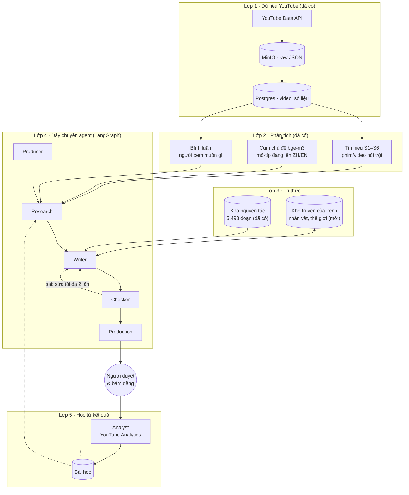
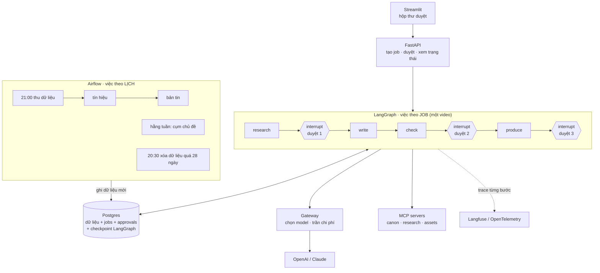
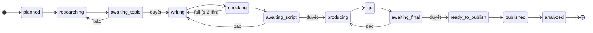

# Kiến trúc YT_ELT Studio

Bản thiết kế ngày 11/11/2026, trước khi code P3–P7. Dựa trên đặc tả Studio
([yt-elt-studio-spec.md](../yt-elt-studio-spec.md)) và quyết định **D9**: chuyên mục Ngụ ngôn được thay
bằng **Phim AI**.

Một kênh YouTube tiếng Việt, 3 chuyên mục:

| Mã | Chuyên mục | Nội dung lấy từ |
|---|---|---|
| `stoic` | Khắc kỷ ứng dụng | Kho nguyên tác: Marcus Aurelius, Seneca, Epictetus |
| `east` | Triết lý phương Đông | Kho nguyên tác: Lão Tử, Trang Tử, Luận Ngữ, Tôn Tử |
| `ai_film` | Phim AI | Truyện **gốc** của kênh; xu hướng học từ kênh phim AI tiếng Trung, Anh, Việt |

## Trả lời nhanh: cần công cụ gì?

| Công cụ | Quyết định | Vì sao |
|---|---|---|
| **LangGraph** | Cần | Quản lý luồng nhiều ngày: dừng chờ người duyệt (`interrupt`), lưu trạng thái vào Postgres (checkpoint), quay lại bước trước khi bị bác |
| **MCP** | Cần (đã có `canon_server`) | Tool dùng chung cho mọi agent, cho Claude và IDE. Thêm `research_server` (dữ liệu YouTube) và `assets_server` (ảnh nhân vật, media) |
| **LangChain** | Không | Đã có `llm.py` + `studio/gateway.py`: gọi model, tính chi phí, ép schema Pydantic. LangGraph chạy không cần LangChain |
| **Airflow** | Giữ | Việc theo lịch: thu dữ liệu, tín hiệu, cụm chủ đề, xóa dữ liệu quá hạn |
| Pydantic | Dùng | Mọi đầu vào/đầu ra của agent là JSON có schema |
| FastAPI + Streamlit | Dùng | API duyệt job + hộp thư duyệt |
| Langfuse + OpenTelemetry | Dùng | Trace từng agent theo job |
| CrewAI / AutoGen | Không | Agent tự nói chuyện với nhau: khó chèn điểm duyệt, khó đoán chi phí |
| n8n | Không | Luồng đã nằm trong Airflow và LangGraph |
| Temporal | Để sau | Bền hơn LangGraph nhưng nặng cho một người vận hành |

## 1. Toàn cảnh hệ thống

Kho truyện (story bible) là phần mới cho Phim AI: lưu nhân vật, ảnh mẫu nhân vật, bối cảnh, tóm tắt
các tập đã làm, để các tập sau nhất quán.

## 2. Luồng làm một tập Phim AI

Ba điểm dừng chờ người duyệt (⏸). Không agent nào được tự đăng lên YouTube.

```mermaid
flowchart LR
  A["Airflow hằng ngày<br/>thu số liệu kênh phim AI<br/>ZH · VI · EN"] --> B["Research<br/>phim nào nổi, mô-típ nào hot,<br/>ZH có mà VI chưa có"]
  B --> C{{"⏸ Duyệt 1<br/>chọn ý tưởng"}}
  C -- "bác + lý do" --> B
  C -- "đồng ý" --> D["Writer<br/>truyện gốc: bối cảnh Việt,<br/>nhân vật riêng, ≥ 2 mô-típ"]
  D --> E["Checker<br/>độ nguyên bản, tên cấm,<br/>chính sách YouTube"]
  E -- "sai" --> D
  E --> F{{"⏸ Duyệt 2<br/>kịch bản"}}
  F -- "bác" --> D
  F -- "đồng ý" --> G["Production<br/>ảnh nhân vật → clip AI →<br/>giọng thoại → FFmpeg"]
  G --> H["Checker QC<br/>độ dài, âm lượng, phụ đề"]
  H --> I{{"⏸ Duyệt 3<br/>video cuối"}}
  I -- "đồng ý" --> J["Upload private<br/>người bấm public"]
  J --> K["Analyst sau 7 & 28 ngày<br/>ghi bài học"]
```

**Ranh giới nằm trong code:** Research chỉ thấy tiêu đề, mô tả, số liệu, bình luận (YouTube API không
trả nội dung phim; luật R4 cấm tải video/phụ đề kênh khác). Writer phải kết hợp mô-típ từ nhiều nguồn và
đặt trong bối cảnh Việt. Checker so tóm tắt truyện với mọi phim đã theo dõi; quá giống một phim cụ thể,
hoặc dùng tên lấy từ phim khác, thì trả lại.

Luồng của stoic/east giống hệt, chỉ khác Writer lấy câu trích từ kho nguyên tác (MCP `get_passage`) và
Checker so khớp câu trích bằng code.

## 3. Các agent

Vẫn 7 agent. Không cần agent riêng cho Phim AI: Writer, Checker, Production có **chế độ** theo chuyên mục
(style guide và schema khác nhau).

| Agent | Làm gì | Đầu vào → đầu ra | Tool | Model | Trạng thái |
|---|---|---|---|---|---|
| Producer | Nhận yêu cầu tự do, tạo job, gọi agent theo thứ tự, dừng ở 3 điểm duyệt | Yêu cầu → JobPlan | create_job, get_job_state, request_approval | Rẻ | P5 |
| Research | Đề tài có bằng chứng. Phim AI: mô-típ hot, kiểu mở đầu, ngôn ngữ đã lên | Chuyên mục, cửa sổ ngày → TopicBrief / StoryTrendBrief | 8 tool đọc dữ liệu + get_signals, get_topic_clusters, get_comment_insights | Rẻ | Đã có (prompt r2 theo chuyên mục); StoryTrendBrief ở F-01 |
| Report | Bản tin thị trường hằng ngày, bản tin kênh mình hằng tuần | Chuyên mục → Markdown đã kiểm số | Như Research + analytics kênh mình | Rẻ / không LLM | Đã có |
| Writer | Triết lý: kịch bản 3 phần từ nguyên tác. Phim AI: truyện gốc, nhân vật, kịch bản tập, cảnh quay | Brief đã duyệt → Script + ScenePlan (+ StoryBible) | search_canon, get_passage, get_story_bible, get_style_guide, get_past_scripts | Tốt | P3 |
| Checker | Kiểm độc lập (không thấy lập luận của Writer): câu trích, độ nguyên bản, chính sách, bản dịch | Script → CheckReport (pass/warn/fail) | get_passage, originality_check, similarity_check, policy_rules, media_probe | Tốt, khác model Writer | P3 |
| Production | Phần lớn là code. Phim AI: ảnh mẫu nhân vật, clip AI theo cảnh, giọng nhiều vai, FFmpeg | ScenePlan → MediaBundle | tts_synthesize, image_generate, video_generate, ffmpeg_render | Không LLM | P4 |
| Analyst | Sau 7 và 28 ngày: so số liệu thật với tín hiệu lúc chọn đề tài, ghi bài học (≥ 3 video cùng chiều) | youtube_video_id → Learning | get_own_channel_analytics, get_signals_at_time, write_learning | Rẻ | P6 |

## 4. Quản lý các agent

Hai tầng điều phối, mỗi tầng giải một bài toán:

| Thành phần | Lo việc gì |
|---|---|
| **LangGraph** | Mỗi job là một `thread_id`; `interrupt` dừng chờ người (có thể nhiều ngày); checkpoint Postgres nên tắt máy bật lại vẫn tiếp tục đúng bước; bác kèm lý do thì quay lại node trước và agent nhận lý do |
| **Gateway** (đã có) | Việc nào dùng model nào; kiểm trần chi phí **trước** mỗi lần gọi (`short` 3 USD, `long` 10 USD, `film` 10 USD khi làm thử); ghi chi phí theo job và agent |
| **Postgres + hộp thư** | Bảng `jobs`, `job_events`, `approvals`: ai duyệt, lúc nào, lý do, số phút người làm |
| **Langfuse** | Cây bước của một job, chi phí, lỗi, thời gian mỗi agent; bảng `llm_calls` đã có |

## 5. Vòng đời một job

Mọi trạng thái đều có thể sang `rejected` hoặc `failed`; job cũng dừng khi chi phí sắp vượt trần.

## 6. Thứ tự xây

1. **Spec + config cho Phim AI** (D9): chuyên mục `ai_film`, format phim, trần `film`, từ khóa tìm
   kênh phim AI, migration 013. ✅ 11/11/2026
2. **Sửa tìm kiếm nguyên tác** (C-03: 0,642 → mục tiêu 0,8), không tốn tiền.
3. **P3 Writer + Checker** và **P3b Phim AI** (F-01…F-04): StoryTrendBrief, kho truyện, kiểm độ nguyên
   bản. Thử bằng LLM giả.
4. **P4 Production**: FFmpeg trước, rồi ảnh mẫu nhân vật, clip AI, giọng nhiều vai.
   ✅ 11/11/2026 – F-06 bản thử: `film-render` dựng tập 1 của "Còn Bảy Ngày" (2 phút 4 giây, 16:9) và tự cắt
   Short (47 giây, 9:16) từ các cảnh `in_short`; `film-compile` ghép tập thành bản dài có chapters.
   Ảnh còn là ảnh giả lập, giọng là MMS-TTS cục bộ (giấy phép phi thương mại, chỉ để thử).
5. **Thí điểm 3–5 tập bằng tay qua CLI** (F-05, M-06), ghi chi phí và số phút người làm.
6. **P5 LangGraph**: chỉ tự động hóa những bước đã chạy ổn ở bước 5.
7. **P6 Analyst**, rồi **P7 upload private**.
