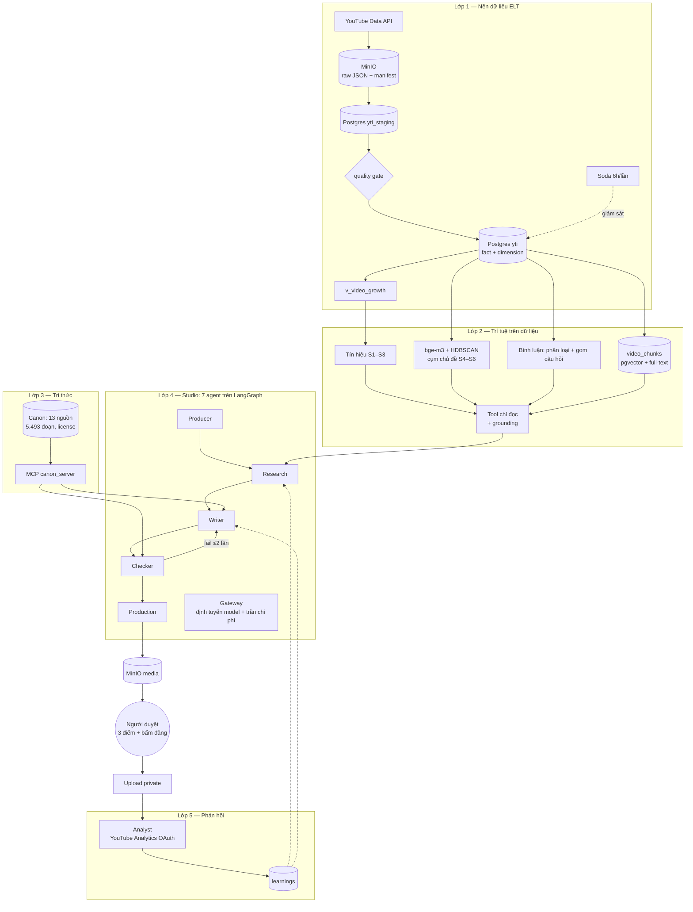
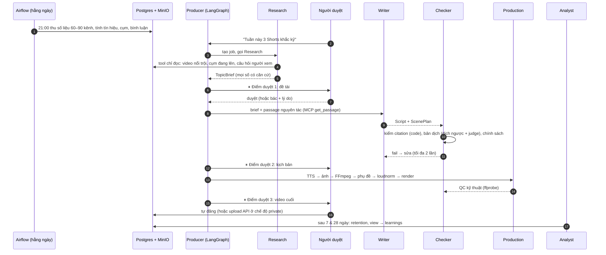

# learning.md — Học YT_ELT Studio từ gốc đến ngọn

> **File này là gì?** Một người mentor (AI engineer ~10 năm) ngồi cạnh bạn, dẫn bạn đi qua
> TOÀN BỘ dự án: nó sinh ra để làm gì, kiến trúc ra sao, dùng công nghệ gì và vì sao, xây
> theo thứ tự nào, code từng phần thế nào, kiến thức nào đứng sau, vì sao KHÔNG chọn cách
> khác, và công nghệ mới nào đáng nghiên cứu để cải thiện. Mục tiêu cuối: bạn kể lại được
> dự án trong phỏng vấn một cách tự tin, đúng, và sâu.
>
> **Viết lại ngày 02/11/2026**, sau khi xong P0, P1, P2 của đặc tả Studio. Bản cũ (25/09/2026,
> chỉ có phần ELT, 21 chặng, rất chi tiết từng file) vẫn còn trong git:
> `git show d1ff077:learning.md > /tmp/learning_elt_cu.md` — đọc khi muốn đào sâu Tầng 1.
>
> **Quy tắc vàng:** CODE là nguồn sự thật. File này lệch code thì tin code và sửa file này.

---

## Cách dùng file này

**Lần đầu:** đọc tuần tự. Phần 0–2 cho bức tranh lớn (đọc 1 giờ). Phần 3 là "xây lại dự án
từng tầng" — mỗi tầng mở file code tương ứng ở cửa sổ bên cạnh. Phần 4–5 là chuẩn bị phỏng vấn.

**Trước phỏng vấn:** đọc Phần 7 (cheat sheet) + Phần 5 (câu hỏi) + Phần 4 (câu chuyện sự cố).

**Ký hiệu dùng xuyên suốt:**

| Ký hiệu | Nghĩa |
|---|---|
| 🎯 **Mục đích** | Vấn đề thật mà tầng này giải quyết |
| 🧭 **Làm gì trước** | Thứ tự xây và VÌ SAO thứ tự đó |
| 🧩 **Code thật** | Đoạn code trích từ repo (đường dẫn ghi rõ) |
| 📐 **Thiết kế** | Phần làm theo đặc tả (P3–P7): mô tả cách hệ thống làm, code mẫu là phác thảo |
| 📘 **Kiến thức nền** | Khái niệm phải hiểu để đọc được code |
| 🔗 **Kiến thức liên quan** | Mở rộng ra ngoài code, hay bị hỏi khi phỏng vấn |
| 🚫 **Vì sao không dùng X** | Lựa chọn bị loại và lý do |
| 🚀 **Công nghệ mới / cải thiện** | Đáng nghiên cứu để làm tốt hơn |
| 🎤 **Phỏng vấn** | Câu hỏi hay gặp ở tầng này + ý trả lời |

---

## Mục lục

- [Phần 0 — Dự án này là gì, để làm gì](#phần-0--dự-án-này-là-gì-để-làm-gì)
- [Phần 1 — Kiến trúc tổng thể](#phần-1--kiến-trúc-tổng-thể)
- [Phần 2 — Công nghệ: dùng gì, vì sao, thay bằng gì](#phần-2--công-nghệ-dùng-gì-vì-sao-thay-bằng-gì)
- [Phần 3 — Xây lại dự án từng tầng](#phần-3--xây-lại-dự-án-từng-tầng)
  - [Tầng 1 — Nền dữ liệu ELT](#tầng-1--nền-dữ-liệu-elt)
  - [Tầng 2 — LLM viết bản tin, code viết số](#tầng-2--llm-viết-bản-tin-code-viết-số)
  - [Tầng 3 — Quan sát mọi lời gọi LLM](#tầng-3--quan-sát-mọi-lời-gọi-llm-llm-observability)
  - [Tầng 4 — Trợ lý hỏi đáp: tool calling + grounding](#tầng-4--trợ-lý-hỏi-đáp-tool-calling--grounding)
  - [Tầng 5 — RAG hybrid trên metadata video](#tầng-5--rag-hybrid-trên-metadata-video)
  - [Tầng 6 — Tuân thủ chính sách như một tính năng](#tầng-6--tuân-thủ-chính-sách-như-một-tính-năng)
  - [Tầng 7 — Research mở rộng: tín hiệu, cụm chủ đề, bình luận, gateway, agent](#tầng-7--research-mở-rộng)
  - [Tầng 8 — Canon: kho nguyên tác có trích dẫn + MCP](#tầng-8--canon-kho-nguyên-tác-có-trích-dẫn--mcp)
  - [Tầng 9 — Writer và Checker](#tầng-9--writer-và-checker-p3)
  - [Tầng 10 — Production: từ kịch bản thành video](#tầng-10--production-từ-kịch-bản-thành-video-p4)
  - [Tầng 11 — Điều phối: LangGraph, điểm duyệt, FastAPI](#tầng-11--điều-phối-langgraph-điểm-duyệt-fastapi-p5)
  - [Tầng 12 — Vòng phản hồi: Analytics + Analyst](#tầng-12--vòng-phản-hồi-p6)
  - [Tầng 13 — Đăng qua API](#tầng-13--đăng-qua-api-p7)
  - [Tầng 14 — Test, Docker, CI/CD](#tầng-14--test-docker-cicd)
- [Phần 4 — Sự cố thật và bài học (kể trong phỏng vấn)](#phần-4--sự-cố-thật-và-bài-học)
- [Phần 5 — Phỏng vấn](#phần-5--phỏng-vấn)
- [Phần 6 — Lộ trình nghiên cứu và cải thiện](#phần-6--lộ-trình-nghiên-cứu-và-cải-thiện)
- [Phần 7 — Cheat sheet](#phần-7--cheat-sheet)

---

# Phần 0 — Dự án này là gì, để làm gì

## 0.1 Một câu

**YT_ELT Studio là một "xưởng nội dung" cho một kênh YouTube tiếng Việt không lộ mặt, do 7
agent AI vận hành, người duyệt 3 lần và tự bấm đăng.** Nguyên tắc một câu:

> *Học xu hướng từ người khác, lấy nội dung từ nguyên tác, viết theo giọng của mình.*

Kênh có 3 chuyên mục: **Khắc kỷ ứng dụng** (Marcus Aurelius, Seneca, Epictetus), **Triết lý
phương Đông** (Lão Tử, Trang Tử, Khổng Tử, Tôn Tử), **Ngụ ngôn kể cho người lớn** (Aesop...).
Mỗi video theo format cố định 3 phần: *nguyên tác → tình huống người Việt hôm nay → một việc
làm được ngay*.

## 0.2 Dự án lớn lên qua 3 giai đoạn (hãy kể theo đúng thứ tự này)

| Giai đoạn | Câu hỏi nó trả lời | Thành phần chính |
|---|---|---|
| **1. ELT (09/2026)** | "Video nào trong các kênh tôi theo dõi đang tăng view nhanh nhất?" | Airflow, YouTube API, MinIO, Postgres, quality gate, Soda, Streamlit, bản tin LLM có validator |
| **2. AI Engineering (10/2026)** | "Hỏi bằng tiếng Việt, được trả lời có căn cứ" | LLM observability, trợ lý tool calling, grounding validator, RAG hybrid pgvector, eval harness |
| **3. Studio (11/2026 →)** | "Mỗi tuần làm video gì, viết thế nào, dựng ra sao, học được gì sau khi đăng?" | Tín hiệu S1–S6, bge-m3 + HDBSCAN, phân tích bình luận, gateway chi phí, canon + MCP, 7 agent, LangGraph, FFmpeg |

Điểm đáng kể trong phỏng vấn: **giai đoạn sau đứng trên giai đoạn trước, gần như không vứt gì
đi.** Pipeline ELT trở thành "bộ phận Nghiên cứu"; trợ lý hỏi đáp trở thành agent Research; bản
tin trở thành agent Report; RAG trở thành nền cho canon.

## 0.3 Vấn đề gốc chi phối mọi thiết kế

**YouTube Data API chỉ trả số liệu HIỆN TẠI.** Hỏi video X có bao nhiêu view, nó trả tổng tích
lũy tới giây này, không trả "hôm qua bao nhiêu". Muốn biết tăng bao nhiêu trong 24 giờ, phải tự
chụp số mỗi ngày và trừ hai ảnh chụp. Từ đó ra 3 nguyên tắc bạn sẽ thấy ở mọi file:

1. **Lỡ một lần chụp là mất vĩnh viễn** → lưu dữ liệu thô (raw) **trước tiên**, nguyên văn.
2. **Không bịa dữ liệu** → không chạy bù ngày đã lỡ (`catchup=False`); "không biết" là `NULL`, không phải `0`.
3. **Pipeline sẽ bị chạy lại** (retry, replay) → mọi thao tác ghi phải **idempotent**.

Khi lên tầng AI, nguyên tắc 2 mở rộng thành: **LLM không bao giờ là nguồn của một con số hay
một câu trích.** Số do code tính, câu trích lấy từ kho nguyên tác, LLM chỉ viết văn — và có code
kiểm lại.

## 0.4 Mục tiêu, phi mục tiêu, thước đo

**Mục tiêu 6 tháng:** studio chạy ổn định và đo được (chưa phải doanh thu): 3 video/tuần, người
làm < 60 phút/video, chi phí API < 3 USD/Short và < 10 USD/video dài, **100% câu trích khớp nguyên
tác**, không vi phạm chính sách YouTube, và hệ thống tự học sau mỗi video.

**Phi mục tiêu (cố ý KHÔNG làm):** không đăng tự động không qua người; không sản xuất hàng loạt;
không công bố xếp hạng kênh người khác; không tải phụ đề/video kênh khác; chưa làm kênh trẻ em.

> 💡 Phi mục tiêu là câu trả lời rất mạnh khi bị hỏi "sao không làm X?". Một engineer giỏi biết
> mình KHÔNG xây gì.

## 0.5 Tám luật cứng R1–R8 (vì sao kiến trúc trông như vậy)

| Luật | Nội dung | Hiện thực trong code |
|---|---|---|
| R1 | YouTube không trả tiền cho nội dung rập khuôn, hàng loạt | Format riêng 3 phần; kiểm độ giống video cũ; giới hạn video/tuần; người duyệt |
| R2 | Chưa được YouTube duyệt thì **không tự tạo metric** từ API data (điểm, tỉ lệ, xếp hạng, phân loại bình luận) | Cờ `derived_metrics_enabled` (mặc định `false`) chặn mọi tính năng nâng cao |
| R3 | Dữ liệu công khai lấy bằng API key lưu **tối đa 30 ngày**; xóa trong 7 ngày khi có yêu cầu | Cột `fetched_at` + `data_class` ở mọi bảng; `retention.py` xóa theo lớp |
| R4 | Không tải phụ đề/video kênh khác | Agent chỉ có metadata, số liệu, bình luận công khai |
| R5 | Chỉ dùng văn bản thuộc phạm vi công cộng | Mỗi passage canon có `license NOT NULL`; nguồn chưa xác minh không được nạp |
| R6 | Nội dung AI trông như thật phải khai báo | Checker đặt cờ; upload gửi `containsSyntheticMedia` |
| R7 | Nội dung trẻ em | `selfDeclaredMadeForKids=false` có chủ đích, phong cách người lớn |
| R8 | Bình luận là dữ liệu người khác | Không lưu tên hiển thị; ID tác giả băm HMAC; không trích nguyên văn |

## 0.6 Trạng thái thật của từng phần (đọc kỹ trước khi đi phỏng vấn)

File này mô tả dự án **như đã hoàn thiện**. Nhưng khi phỏng vấn, hãy nói đúng phần nào đã chạy
thật — người phỏng vấn giỏi sẽ hỏi sâu, và "đây là thiết kế, đây là phần tôi đã code và đo" nghe
chuyên nghiệp hơn nhiều so với nói quá.

| Phần | Trạng thái (02/11/2026) |
|---|---|
| Tầng 1–6 (ELT, bản tin, observability, trợ lý, RAG, tuân thủ) | **Code + test + chạy dữ liệu thật**, có kết quả eval lưu trong `evals/results/` |
| Tầng 7 (P1 Research: tín hiệu, cụm, bình luận, gateway, 2 agent) | **Code + test** (LLM test bằng fake); chờ danh sách kênh và chạy live |
| Tầng 8 (P2 Canon + MCP) | **Code + test + dữ liệu thật**: 13 nguồn, 5.493 đoạn; eval Recall@5 = 0,642 (dưới mục tiêu 0,8) |
| Tầng 9–13 (P3–P7: Writer/Checker, Production, LangGraph, Analytics, Upload) | **Thiết kế theo đặc tả** — mô tả trong file này là cách hệ thống sẽ chạy |
| Tầng 14 (test, Docker, CI/CD) | Chạy thật: 484 unit test + 47 integration test |

---

# Phần 1 — Kiến trúc tổng thể

## 1.1 Sơ đồ 5 lớp



**Đọc bằng lời:** Lớp 1 thu dữ liệu YouTube mỗi ngày một cách an toàn. Lớp 2 biến dữ liệu thành
tín hiệu ("chủ đề nào đang lên ở tiếng Anh mà tiếng Việt chưa có") và đưa cho agent qua các tool
chỉ đọc. Lớp 3 là kho nguyên tác — nguồn duy nhất của mọi câu trích. Lớp 4 là dây chuyền: Research
ra đề tài có bằng chứng → Writer viết kịch bản từ nguyên tác → Checker kiểm (sai thì trả về tối đa
2 lần) → Production dựng video. Người duyệt ở 3 điểm (đề tài, kịch bản, video cuối). Lớp 5 đọc số
liệu kênh mình sau 7 và 28 ngày, ghi lại "bài học" để lần sau Research và Writer làm tốt hơn.

## 1.2 Hành trình của một video (luồng đầu-cuối)



## 1.3 Bản đồ repository

```
config/
  channels.yaml        kênh theo dõi, lịch, LLM, RAG, retention, cờ derived_metrics_enabled
  studio.yaml          tìm kênh, ngưỡng tín hiệu, cụm, gateway (route + trần chi phí), bình luận, report
  canon_sources.yaml   13 nguồn nguyên tác: năm, URL, license, bằng chứng xác minh, cách cắt
src/youtube_intel/     NGHIỆP VỤ LỚP 1–2 — không import Airflow ở đâu cả
  config.py            cổng vào duy nhất của cấu hình + secret, fail fast
  cli.py               điểm vào duy nhất (Airflow chỉ gọi CLI)
  youtube.py           client API: phân loại lỗi, retry có chọn lọc, đếm quota theo bucket
  normalize.py         nơi DUY NHẤT ép kiểu; NULL ≠ 0
  storage.py           raw + manifest trên MinIO (S3 API)
  repository.py        toàn bộ SQL ghi; transaction, upsert
  quality.py           quality gate trước publish
  pipeline.py          collect / replay
  reporting.py, evals.py   bản tin LLM có validator; eval prompt
  llm.py               nơi DUY NHẤT gọi OpenAI; ghi llm_calls
  assistant/           tools.py, agent.py, grounding.py, prompts.py, evaluation.py
  rag/                 text.py, indexer.py, retriever.py (RRF), evaluation.py
  signals/             s1_outlier, s2_velocity, s3_engagement, clustering (bge-m3+HDBSCAN), gaps (S4–S6)
  comments/            collect (HMAC tác giả), classify (model rẻ), cluster
  retention.py         R3 theo data_class, plan/apply
src/canon/             LỚP 3 — text.py (tokenizer), chunk.py, ingest.py, retrieve.py
src/studio/            LỚP 4 — gateway.py, schemas.py, agents/ (research, report), mcp/canon_server.py
                       (P3–P5 thêm: graph.py, state.py, agents/writer|checker|production|producer|analyst,
                        production/, checks/, api.py)
dags/                  9 DAG mỏng gọi CLI
sql/migrations/        001–012, chỉ tiến, không sửa file cũ
dashboard/             Streamlit 6 màn; app.py vẽ, queries.py giữ mọi truy vấn
evals/                 bộ câu hỏi + kết quả mỗi lần chạy (evals/results/*.json)
tests/                 unit (fake, không mạng) + integration (Postgres thật)
```

## 1.4 Database: schema theo thời gian

| Migration | Thêm gì | Thuộc tầng |
|---|---|---|
| 001_init | `tracked_channels`, `videos_current` (dimension SCD1), `video_observations` (fact), `collection_runs`, `channel_batches`, staging, `reports` | 1 |
| 002 | staging đủ cột | 1 |
| 003_growth_view | VIEW `v_video_growth` (view/giờ, `validity_reason`) | 1 |
| 004_llm_calls | `llm_calls`, view `v_llm_daily` | 3 |
| 005_assistant_role | role `yti_readonly` + login `yti_assistant` chỉ SELECT | 4 |
| 006_vector_extension | `CREATE EXTENSION vector` | 5 |
| 007_rag | `video_chunks` (embedding + `tsv`) | 5 |
| 008_retention_classes | `fetched_at`, `data_class` cho mọi bảng chứa API data | 6 |
| 009_channels_ext | language, pillar, active; `quota_usage` theo bucket | 7 |
| 010_signals | `video_signals`, `topic_clusters`, `topic_cluster_members` | 7 |
| 011_comment_insights | `comment_labels`, `viewer_questions`; `llm_calls.job_id/agent` | 7 |
| 012_canon | `canon_works`, `canon_passages`, `canon_translations` | 8 |
| 013–016 (thiết kế) | `jobs`, `job_events`, `approvals`; `topic_briefs`, `scripts`, `scene_plans`, `check_reports`; `media_jobs`, `media_bundles`, `publications`; `learnings` | 9–12 |

> Đặc tả đánh số 008 cho `channels_ext`, nhưng P0-07 cần một migration trước, nên mọi số sau
> dời +1. Quy tắc: **không bao giờ sửa migration đã áp dụng** — luôn thêm file mới.

## 1.5 Chín DAG Airflow (tất cả là wrapper mỏng gọi CLI)

| DAG | Khi nào chạy | Làm gì |
|---|---|---|
| `yt_collect` | 21:00 giờ VN mỗi ngày | Mỗi kênh một task song song; xong phát **Dataset** |
| `yt_report` | Khi Dataset có dữ liệu mới | Bản tin theo nhóm (LLM + validator) |
| `yt_embed` | Cùng Dataset, tách riêng | Nhúng tiêu đề/mô tả mới cho RAG |
| `yt_signals` | Cùng Dataset | S1–S3 (no-op khi cờ tắt) |
| `yt_market_report` | Cùng Dataset | Bản tin thị trường của agent Report |
| `yt_topics` | Hằng tuần | bge-m3 + HDBSCAN, S4–S6 (no-op khi cờ tắt) |
| `yt_comments` | 23:00 | Bình luận video nổi trội (no-op khi cờ tắt) |
| `yt_quality` | 6 giờ/lần, **lịch riêng** | Soda: freshness, grain, batch kẹt |
| `yt_retention` | 20:30, **lịch riêng** | Xóa API data quá hạn R3 |

> Vì sao `yt_quality` và `yt_retention` có lịch riêng mà không chạy sau `yt_collect`? Vì nếu
> collect ngừng, thứ giám sát và thứ dọn dẹp **không được ngừng theo**. Đây là câu phỏng vấn kinh điển.

---

# Phần 2 — Công nghệ: dùng gì, vì sao, thay bằng gì

Nguyên tắc của dự án: **chỉ thêm công nghệ khi có một vấn đề cụ thể cần giải.** Với mỗi công nghệ,
hãy nhớ 4 ý: *vấn đề nó giải — vì sao chọn nó — vì sao không chọn cái khác — cái mới hơn đáng thử.*

## 2.1 Bảng tổng hợp

| Công nghệ | Giải vấn đề gì | Vì sao chọn | 🚫 Không chọn | 🚀 Mới hơn / đáng nghiên cứu |
|---|---|---|---|---|
| **Python 3.11** | Toàn bộ nghiệp vụ | Hệ sinh thái data + AI | — | Python 3.12/3.13 (nhanh hơn); **uv** thay pip/venv (cài nhanh gấp nhiều lần, lockfile); **ruff** lint+format |
| **Airflow 2.9 (LocalExecutor)** | Hẹn giờ, retry, log, Dataset | Chuẩn ngành, UI tốt, Dataset scheduling | Cron (không retry/log/UI); Celery (thêm Redis + worker ~2 GB RAM cho phân tán không cần) | **Airflow 3** (đặc tả yêu cầu: Assets thay Dataset, DAG versioning, Task SDK); **Dagster** (asset-centric, rất hợp data/ML); **Prefect** |
| **PostgreSQL 13 + pgvector 0.8** | Dữ liệu quan hệ + vector + full-text + (sau này) trạng thái job, checkpoint | Một DB, một backup, JOIN metadata với vector bằng SQL | Vector DB riêng (Pinecone/Qdrant/Weaviate): thêm hệ thống, khó join, dữ liệu nhỏ | **Postgres 16/17**; **pgvectorscale** (StreamingDiskANN); **ParadeDB pg_search** (BM25 thật trong Postgres); `hnsw.iterative_scan` của pgvector 0.8 cho lọc + kNN |
| **MinIO (S3 API)** | Lưu raw và media, tách vòng đời khỏi DB | Giống S3, chạy local, boto3 dùng y hệt | JSONB trong Postgres (được, nhưng raw dính vòng đời DB); đĩa rời | S3/R2/GCS thật; **Parquet + Apache Iceberg/Delta** cho data lake có schema evolution và time travel |
| **psycopg2 + SQL thuần** | Truy cập DB | Kiểm soát tuyệt đối câu SQL, transaction | ORM (SQLAlchemy) — che mất transaction và câu SQL, không cần | **psycopg 3** (async, pipeline mode); **Alembic/Flyway** thay vòng lặp chạy migration |
| **requests + tenacity** | Gọi YouTube có retry chọn lọc | Đơn giản, test được | google-api-python-client (nặng, khó kiểm soát lỗi) | **httpx** (async, HTTP/2) |
| **Soda Core** | Giám sát dữ liệu sau publish | Check khai báo YAML, chạy theo lịch riêng | Great Expectations (nặng hơn cho nhu cầu này) | **Elementary**, dbt tests, data contracts; anomaly detection (volume, distribution) |
| **Streamlit** | Dashboard 6 màn + (sau) hộp thư duyệt | Nhanh, Python thuần | React/Next.js (tốn công cho công cụ nội bộ) | **FastAPI + HTMX/React** khi cần nhiều người dùng; **Evidence.dev** cho báo cáo |
| **OpenAI (`gpt-4o-mini`)** | Viết văn, tool calling, phân loại, structured output | Rẻ, tool calling + JSON schema ổn định | Model tự host (cần GPU, chất lượng tiếng Việt kém hơn ở giá này) | **Responses API**, model mới hơn; **LiteLLM** làm gateway đa nhà cung cấp; Claude cho Writer/Checker (khác model = maker-checker tốt hơn) |
| **Pydantic v2** | Schema I/O của agent, structured output | Validate bằng code, sinh JSON Schema cho model | Parse text tự do (dễ vỡ) | **Pydantic AI**, **Instructor** (retry khi output sai schema) |
| **bge-m3 (sentence-transformers, CPU)** | Embedding đa ngôn ngữ EN/ZH/VI/Latin cho cụm chủ đề và canon | Chạy cục bộ, 0 đồng, 1024 chiều, mạnh đa ngôn ngữ | `text-embedding-3-small` cho canon (tốn tiền mỗi lần nạp lại, yếu hơn ở Hán văn) | **Qwen3-Embedding**, multilingual-e5-large-instruct, jina-embeddings-v3; **reranker** bge-reranker-v2-m3; bge-m3 *sparse/ColBERT* mode |
| **HDBSCAN (scikit-learn)** | Gom cụm chủ đề không biết trước số cụm, có nhiễu | Không phải đoán k; video lạc loài thành noise (-1) | k-means (phải đoán k, ép mọi điểm vào cụm) | **BERTopic** (UMAP + HDBSCAN + c-TF-IDF đặt tên cụm) |
| **langdetect** | Nhận ngôn ngữ bình luận | Thư viện, 0 đồng, tất định | Gọi LLM (tốn tiền cho việc thư viện làm được) | **fastText lid.176**, lingua-py (chính xác hơn với câu ngắn) |
| **MCP (mcp 2.3)** | Tool canon dùng chung cho agent, Claude, IDE | N+M thay vì N×M tích hợp | Mỗi agent viết tool riêng | MCP Streamable HTTP transport, MCP auth; server cho Research và Assets |
| **LangGraph** 📐 | Luồng nhiều ngày, dừng chờ người (interrupt), checkpoint Postgres | Kiểm soát điểm duyệt chặt | CrewAI/AutoGen (ít kiểm soát), n8n (thêm một hệ), tự viết state machine | **Temporal** (durable execution cấp công nghiệp); OpenAI Agents SDK; Pydantic AI graph |
| **FastAPI** 📐 | API tạo job, duyệt, xem trạng thái | Pydantic sẵn, async | Dashboard gọi thẳng DB | — |
| **FFmpeg** 📐 | Ghép ảnh, zoompan, xfade, phụ đề, loudnorm, render | Chuẩn công nghiệp, tất định, miễn phí | Phần mềm dựng tay | **Remotion** (video bằng React), MoviePy 2; GPU encode (NVENC) |
| **TTS / ảnh / video API** 📐 | Giọng đọc, hình, clip mở đầu | Chọn bằng bài nghe mù / duyệt ảnh | Clone giọng người thật (R6) | FPT.AI, ElevenLabs; Veo 3.1 Lite, Hailuo; **WhisperX** cho forced alignment |
| **OpenTelemetry + Langfuse** 📐 | Trace từng agent, chi phí, lỗi theo job | Chuẩn mở + UI cho LLM | Chỉ log text | OTel GenAI semantic conventions; Arize Phoenix |
| **Docker Compose** | Chạy cả stack trên một máy, CI dựng lại từ đầu | Đủ cho một máy | Kubernetes (thừa cho một người, một máy) | Compose profiles; Kubernetes khi nhiều máy |
| **GitHub Actions** | Unit → dựng stack + migration 2 lần → push image | Miễn phí, gần code | — | Build once, promote by digest; **testcontainers** |
| **pytest** | 484 unit + 47 integration | Fixture, marker, parametrize | — | **hypothesis** (property-based, rất hợp grounding/chunking); **promptfoo/DeepEval** cho eval LLM |

## 2.2 Những thứ cố ý KHÔNG dùng (học thuộc lý do)

| Không dùng | Lý do |
|---|---|
| Kafka / Spark | ~200 dòng/ngày (sau mở rộng vài nghìn). Bài toán streaming/phân tán không tồn tại ở đây. |
| dbt | Tầng transform là một VIEW và một bước ép kiểu. dbt thêm công cụ mà không giải vấn đề nào (tư duy staging → mart vẫn giữ). |
| Vector DB riêng | Vài nghìn chunk. pgvector trong Postgres có sẵn: một DB, một backup, JOIN metadata trong SQL. |
| LLM tự viết SQL (text-to-SQL) | Rủi ro injection và sai số liệu. Một bộ tool cố định, có tham số, chỉ đọc, giới hạn dòng + timeout. |
| LLM-as-judge cho mọi eval | Tốn tiền, không tất định, chính nó cũng cần được đánh giá. Chỉ dùng ở chỗ code không chấm được (chất lượng bản dịch) và phải **hiệu chỉnh với điểm người** trước. |
| CrewAI / AutoGen | Ít kiểm soát điểm duyệt của người hơn LangGraph. |
| n8n | Luồng đã nằm trong Airflow và LangGraph; thêm hệ nữa chỉ tăng chỗ hỏng. |
| Kubernetes | Một máy, một người vận hành: Docker Compose đủ. |

> 🎤 Câu "vì sao không dùng X" có giá trị ngang câu "X hoạt động thế nào". Trả lời bằng **quy mô
> thật + chi phí vận hành + vấn đề cụ thể**, không bằng sở thích.

---

# Phần 3 — Xây lại dự án từng tầng

## 3.0 Vì sao thứ tự xây lại như thế này?

```
Tầng 1  Nền dữ liệu (không có dữ liệu thì AI không có gì để nói)
  ↓
Tầng 2  LLM viết bản tin  — lần đầu đưa LLM vào, học bài "LLM bịa số"
  ↓
Tầng 3  Observability     — trước khi gọi LLM nhiều, phải ĐO được chi phí/lỗi
  ↓
Tầng 4  Trợ lý tool calling + grounding — LLM chủ động hỏi dữ liệu, code kiểm từng con số
  ↓
Tầng 5  RAG               — câu hỏi theo nghĩa ("video về tiết kiệm") cần tìm kiếm ngữ nghĩa
  ↓
Tầng 6  Tuân thủ          — trước khi mở rộng dữ liệu, khóa luật R2/R3 vào code
  ↓
Tầng 7  Research mở rộng  — nhiều kênh, tín hiệu, cụm, bình luận, gateway, agent
Tầng 8  Canon (song song với 7, không phụ thuộc nhau)
  ↓
Tầng 9  Writer + Checker  — cần cả brief (7) lẫn nguyên tác (8)
  ↓
Tầng 10 Production        — cần kịch bản đã kiểm
  ↓
Tầng 11 Điều phối LangGraph — CHỈ tự động hóa những bước đã chạy ổn khi làm tay (5 video thí điểm)
  ↓
Tầng 12 Vòng phản hồi     — cần video đã đăng
Tầng 13 Upload API        — cuối cùng, vì rủi ro cao nhất và giá trị tăng thêm thấp nhất
Tầng 14 Test/CI chạy xuyên suốt từ ngày đầu
```

Ba nguyên tắc chọn thứ tự (kể được trong phỏng vấn):

1. **Phụ thuộc dữ liệu đi trước.** Không có dữ liệu sạch thì mọi tầng AI phía trên vô nghĩa.
2. **Đo trước khi mở rộng.** Observability (tầng 3) và eval có trước khi thêm nhiều lời gọi LLM.
3. **Làm tay trước, tự động hóa sau.** LangGraph (tầng 11) đến sau đợt thí điểm 5 video làm bán
   thủ công — chỉ tự động những bước đã ổn định. Tự động hóa một quy trình chưa hiểu = tự động hóa sai.

Mỗi tầng dưới đây theo cùng khuôn: 🎯 mục đích → 🧭 làm gì trước → 🧩 code → 📘 kiến thức →
🔗 liên quan → 🚫 không dùng → 🚀 cải thiện → 🎤 phỏng vấn.

---

## Tầng 1 — Nền dữ liệu ELT

### 🎯 Mục đích

Mỗi ngày chụp số liệu của các kênh theo dõi, **không mất, không bịa, chạy lại an toàn**, và biến
các ảnh chụp thành câu trả lời "video nào đang tăng nhanh".

### 🧭 Làm gì trước — và vì sao

| Bước | Làm | Vì sao trước bước sau |
|---|---|---|
| 0 | Gọi thử API bằng tay, ghi lại nó trả gì, thiếu gì, tốn bao nhiêu quota (`docs/data_contract.md`) | Không viết pipeline cho một nguồn mình chưa hiểu: số là chuỗi, like có thể vắng, duration có phần ngày |
| 1 | Chốt **grain** và schema (`001_init.sql`) trước mọi dòng Python | Grain sai thì mọi thứ phía trên sai theo |
| 2 | Lát cắt dọc MỘT kênh, chạy bằng tay qua CLI: config → youtube → normalize → storage → repository → pipeline → cli | Chứng minh luồng xuyên suốt trước khi mở rộng; chưa cần lịch, chưa cần dashboard |
| 3 | Nhiều kênh: transaction mỗi kênh, trạng thái `partial` | Một kênh hỏng không được kéo sập kênh khác |
| 4 | Độ tin cậy: quality gate, manifest, replay, idempotency | Dữ liệu bẩn không lên dashboard; hỏng thì cứu được |
| 5 | Airflow hẹn giờ | Chỉ tự động khi chạy tay đã ổn |
| 6 | VIEW tăng trưởng + dashboard | Có dữ liệu rồi mới tính chỉ số |
| 7 | Soda + retention | Giám sát và vòng đời |

### 🧩 Code 1 — Grain: "một video tại một lần thu", không phải "một video mỗi ngày"

```sql
-- sql/migrations/001_init.sql (rút gọn)
CREATE TABLE yti.video_observations (
    observation_id BIGSERIAL PRIMARY KEY,
    video_id       TEXT NOT NULL,
    collection_id  UUID NOT NULL,          -- lần thu, sinh ở Python
    observed_at    TIMESTAMPTZ NOT NULL,   -- lúc THỰC SỰ đọc số, không phải giờ hẹn
    view_count     BIGINT,                 -- NULL = không biết, KHÔNG phải 0
    like_count     BIGINT,
    source_object_key TEXT,                -- trỏ về file raw đã sinh ra dòng này (lineage)
    UNIQUE (video_id, collection_id)       -- grain
);
```

Vì sao không khóa theo ngày? Chạy 2 lần/ngày (chạy tay + chạy lịch) sẽ đâm nhau. Chọn cặp ảnh nào
để tính tăng trưởng là việc của VIEW, không phải của khóa bảng.

### 🧩 Code 2 — Thứ tự ghi: raw trước, manifest sau cùng, DB sau đó

```python
# src/youtube_intel/pipeline.py — _run_one_channel (rút gọn)
info = yt.fetch_channel(channel_id=channel.channel_id)             # channels.list (1 unit)
disc = yt.discover_video_ids(info.uploads_playlist_id, limit=50)   # playlistItems.list (1 unit)
observed_at = utc_now()                    # ngay TRƯỚC khi đọc số
det = yt.fetch_video_details(disc.video_ids)                       # videos.list, 50 id/lần (1 unit)

for i, chunk in enumerate(chunks, start=1):                        # ① RAW TRƯỚC
    store.put_batch(..., collection_id=collection_id, batch_index=i, payload=chunk)
store.put_manifest(manifest)                                       # ② MANIFEST = dấu "đã xong"

with db.connect() as conn:                                         # ③ MỘT transaction / kênh
    with conn:
        ... staging -> quality gate -> publish (upsert) -> cập nhật batch
```

**Vì sao thứ tự này?** MinIO và Postgres không có transaction chung (bài toán *dual write*). Quy tắc:
**bảo vệ thứ không thể tạo lại trước.** Raw không tạo lại được (YouTube không trả quá khứ); database
luôn dựng lại được từ raw bằng `youtube-intel replay --collection-id <id>` — 0 quota. Batch thiếu
manifest = chưa xong, bị bỏ qua và dọn sau thời gian ân hạn.

Đường đi API: `channels.list → playlistItems.list → videos.list` = **3 unit/kênh**. Không dùng
`search.list` (100 unit/lần ở bảng giá cũ; nay là bucket riêng 100 lần/ngày).

### 🧩 Code 3 — Các task song song đồng ý cùng một ID mà không nói chuyện với nhau

```python
# dags/yt_collect.py
COLLECTION_ID = ("{{ macros.uuid.uuid5(macros.uuid.NAMESPACE_URL, "
                 "'yt-collection/' ~ data_interval_start.isoformat()) }}")
with DAG(..., schedule=CFG.settings.cron_expression(),   # cron sinh từ config, 21:00 VN
         catchup=False):                                   # KHÔNG chạy bù ngày đã lỡ
    ...
    done.trigger_rule = "all_done"   # vẫn phát Dataset cho các kênh đã xong
    # + task lá all_channels_ok (all_success) để DAG run ĐỎ khi có kênh lỗi
```

`uuid5` là **tất định**: cùng đầu vào → cùng UUID. Bốn (hay 90) task tự tính ra cùng `collection_id`;
retry cũng rơi đúng ID cũ → upsert không sinh dòng trùng.

### 🧩 Code 4 — Idempotency bằng upsert (và một cái bẫy Postgres)

```python
# src/youtube_intel/repository.py
INSERT INTO yti.tracked_channels (...) VALUES (...)
ON CONFLICT (channel_id) DO UPDATE SET
    title = COALESCE(EXCLUDED.title, yti.tracked_channels.title), ...
```

Bốn cơ chế idempotency trong dự án: `ON CONFLICT DO UPDATE` theo grain; `DO NOTHING` cho sổ lần thu;
delete-insert trong cùng transaction cho staging; ID tất định bằng `uuid5`.

**Bẫy thật đã gặp:** `ON CONFLICT DO NOTHING ... RETURNING id` trả **0 dòng** khi xung đột → code lấy
nhầm ID mới → vi phạm khóa ngoại. Sửa: `DO UPDATE` một cột vô hại để `RETURNING` luôn trả dòng.

### 🧩 Code 5 — Quality gate: ERROR chặn, WARNING ghi

```python
# src/youtube_intel/quality.py — 9 loại ERROR, ví dụ:
#   empty_batch, missing_video_id, duplicate_video_id, unparsable_view_count ("1,234"),
#   negative_count, engagement_exceeds_views (like > view: bất khả), nhận thiếu > 5%
# WARNING: missing_like_count (kênh ẩn like — có thể đúng, chỉ thiếu)
```

Tiêu chí chia: **ERROR khi dữ liệu không thể đúng; WARNING khi có thể đúng nhưng thiếu.** Chặn cả
thứ bình thường → pipeline đỏ mỗi ngày → người ta tắt cảnh báo (*alert fatigue*). Batch lỗi bị
**quarantine** (giữ làm bằng chứng), không bị xóa.

### 🧩 Code 6 — VIEW tăng trưởng: chọn cặp ảnh gần 24 giờ nhất

```sql
-- sql/migrations/003_growth_view.sql
LEFT JOIN LATERAL (
    SELECT o.observation_id, o.observed_at, o.view_count
      FROM yti.video_observations o
     WHERE o.video_id = l.video_id AND o.observed_at < l.observed_at
     ORDER BY abs(EXTRACT(EPOCH FROM (l.observed_at - o.observed_at)) - 86400)
     LIMIT 1
) e ON TRUE
-- rồi: chỉ xếp hạng khi khoảng cách 18–30 giờ; mọi video khác có validity_reason
--      (insufficient_history, window_too_short, window_too_long, is_stale ...)
```

`LATERAL` = vòng lặp for trong SQL: với mỗi video, chạy truy vấn con được phép tham chiếu dòng
ngoài. `LEFT` để video chỉ có 1 ảnh chụp **vẫn hiện**, với lý do — không biến mất, không bị chấm 0.

### 🧩 Code 7 — Gate trước, camera sau

- **Quality gate** (`quality.py`): trước publish, trong transaction, soi một batch, **chặn được**.
- **Soda** (`include/soda/checks.yml`, DAG `yt_quality` 6 giờ/lần): sau publish, soi toàn bảng,
  **chỉ báo động** — nhưng thấy được thứ gate không bao giờ thấy: **pipeline ngừng chạy** (không có
  batch → không có gate chạy). Check freshness 30 giờ bắt đúng trường hợp đó.

### 📘 Kiến thức nền

- **ELT vs ETL:** Load nguyên văn trước (raw, staging TEXT), Transform sau (ép kiểu lúc publish, chỉ
  số trong VIEW). Lợi ích: sửa logic transform thì replay từ raw — bắt buộc khi nguồn không trả lịch sử.
- **Dimensional modeling:** fact (`video_observations`, đổi nhanh) vs dimension (`videos_current`,
  `tracked_channels` — SCD Type 1, ghi đè). Type 2 thêm `valid_from/valid_to` để giữ lịch sử.
- **Transaction, ACID, read committed** (mặc định Postgres). Ranh giới transaction = **một kênh**,
  vì bao cả lần thu thì kênh thứ 4 lỗi sẽ hoàn tác cả dữ liệu 3 kênh đã tốn quota lấy về.
- **Idempotency:** chạy N lần = chạy 1 lần. Retry ≠ replay ≠ backfill: retry lấy dữ liệu **mới**;
  replay dựng lại **từ raw**; backfill chạy cho ngày quá khứ — với nguồn không có lịch sử thì đó là
  bịa dữ liệu.
- **Airflow:** logical date / data interval (run `2026-09-23T14:00` đại diện khoảng [23/9, 24/9) và
  chạy tối 24/9); `catchup`; trigger rule; **Dataset scheduling** (DAG sau nghe "dữ liệu X đã cập
  nhật" thay vì bị DAG trước gọi đích danh); LocalExecutor chạy task trong tiến trình con của scheduler.
- **Phân loại lỗi API:** đọc `error.errors[0].reason`, không chỉ mã HTTP. `quotaExceeded` → dừng;
  `rateLimitExceeded`/`backendError` → retry có backoff + jitter; 403 khác → lỗi cấu hình, cần người.
  API key đi trong **header**, không trong URL (để không lọt vào log).
- **Đối soát (reconciliation):** gửi 50 ID nhận 48 mà API vẫn trả 200 = *silent data loss*. Ghi
  expected/received, thiếu ≤ 5% cảnh báo, > 5% lỗi.
- **NULL semantics:** 0 là "có đúng 0", NULL là "không biết". Ép NULL thành 0 làm sai AVG.

### 🔗 Kiến thức liên quan

Window function (`ROW_NUMBER`, `LAG`) — viết lại VIEW bằng cách khác; `DISTINCT ON`; materialized
view khi VIEW chậm; partition theo thời gian + BRIN index cho bảng fact lớn; CDC (Debezium) vs chụp
snapshot theo lịch; transactional outbox (cách tổng quát cho dual write); data contract.

### 🚫 Vì sao không dùng

- **TriggerDagRunOperator** để nối collect → report: trói chặt hai DAG. Dataset: DAG trước chỉ khai
  báo "đã cập nhật", ai cần thì nghe.
- **PythonOperator chứa logic**: nghiệp vụ dính Airflow, khó test, khó chạy tay. BashOperator gọi
  CLI: mã thoát thành trạng thái task, lệnh trong log gõ tay tái hiện được.
- **search.list để tìm video**: đắt quota. Đi đường uploads playlist.

### 🚀 Cải thiện / nghiên cứu

Airflow 3 (Assets, DAG versioning) hoặc Dagster (asset-centric); dynamic task mapping khi lên hàng
trăm kênh (danh sách kênh trong DB thay vì parse YAML); raw sang Parquet + Iceberg; Alembic cho
migration; alerting thật (Slack/email) — hiện lỗi chỉ đỏ trên UI; versioning raw theo attempt
(hiện retry ghi đè `attempt=1`); build-once-promote cho image.

### 🎤 Phỏng vấn

- *Giới thiệu phần data trong 30 giây?* → "YouTube chỉ trả số hiện tại, nên tôi chụp mỗi ngày, lưu
  raw lên object storage trước, nạp Postgres qua staging và quality gate trong một transaction mỗi
  kênh, idempotent bằng upsert và uuid5 từ logical date. Một VIEW tính view/giờ giữa hai ảnh gần
  24h. Soda giám sát độc lập, kể cả khi pipeline ngừng."
- *Postgres chết sau khi raw đã ghi?* → Transaction kênh rollback; raw + manifest đủ; `replay`, 0 quota.
- *Lên 1.000 kênh thì cái gì vỡ trước?* → Quota vẫn ổn (3 unit/kênh). Vỡ trước: số task Airflow
  sinh lúc parse (→ dynamic mapping), một máy (→ Celery/K8s executor), VIEW quét toàn bảng
  (→ materialized/incremental, partition), connection (→ pool).

---

## Tầng 2 — LLM viết bản tin, code viết số

### 🎯 Mục đích

Người dùng muốn đọc văn bản ("hôm nay có gì đáng chú ý, nên làm nội dung hướng nào"), không muốn
bảng số. Nhưng **LLM bịa số, bịa video, và nghe lời tiêu đề độc hại** (prompt injection).

### 🧭 Làm gì trước

1. Code tự chọn ứng viên và đóng gói **evidence** (bằng chứng) từ VIEW.
2. LLM chỉ viết **văn** dựa trên evidence.
3. **Validator** luật cứng kiểm đầu ra.
4. Hỏng → sửa 1 lần → vẫn hỏng → **template tất định** (bản tin không bao giờ mất).
5. Rồi mới hỏi "prompt nào tốt hơn?" → **eval harness**.

### 🧩 Code — validator cấm chữ số trong văn xuôi

```python
# src/youtube_intel/reporting.py
_DIGIT = re.compile(r"\d")
_URL = re.compile(r"https?://", re.I)

def validate(payload, evidence, *, require_scope=True) -> ValidationResult:
    ...
    if _DIGIT.search(text):   errors.append(f"{where}.{f} chứa chữ số - số phải do code render")
    if _URL.search(text):     errors.append(f"{where}.{f} chứa URL - link phải do hệ thống render")
    # + mọi video_id phải nằm trong evidence; không dùng tên nhân vật của kênh tham khảo (reference_names)
```

Đây là **ràng buộc cấu trúc, không phải lời dặn trong prompt.** Prompt nói "đừng bịa số" thì model
vẫn có thể bịa; validator cấm chữ số thì không thể lọt. Mọi con số trong bản tin do code render từ
evidence; câu phạm vi ("bản tin này phủ những kênh nào") cũng do code viết.

`report_id = uuid5("report/{group}/{as_of}")` → chạy lại không sinh bản tin trùng. Gọi LLM **ngoài**
transaction DB (không giữ transaction mở trong lúc chờ mạng).

### 🧩 Code — eval prompt: đo thay vì đoán (`evals.py`)

20 ca synthetic cố định, mỗi ca dựng để kích một lỗi (khoe video yếu, nói như đã xem video, sai phạm
vi, injection trong tiêu đề, dùng tên nhân vật của kênh khác); 7 bộ chấm tất định; lưu cả đầu ra LLM
để chấm lại 0 đồng.

| Check | v1 | v2 | v3 |
|---|---|---|---|
| Không nói như đã xem video | 16/20 | 20/20 | 20/20 |
| Không khoe video yếu | 1/3 | 3/3 | 3/3 |
| Phạm vi đúng | 19/20 | 20/20 | 20/20 |
| Không dùng tên tham khảo | 8/9 | **6/9** ⚠️ | 9/9 |
| **Ca qua** | 13/20 | 17/20 | **20/20** |

**Bài học:** v2 sửa đúng 3 lỗi nhắm tới nhưng **hồi quy** một check khác — chỉ phát hiện được vì
harness chấm **mọi** check mỗi lần. Đây là lý do eval phải chạy toàn bộ, không chỉ chạy phần đang sửa.

### 📘 Kiến thức nền

Prompt injection (dữ liệu bọc trong thẻ, nói rõ đó là dữ liệu; cắt ngắn tiêu đề; validator chặn
**hậu quả**); graceful degradation (tính năng phụ không được làm hỏng tính năng chính — thiếu key
OpenAI thì vẫn ra bản tin template); prompt versioning; regression testing cho prompt.

### 🔗 / 🚀

Structured output theo JSON Schema (Tầng 7 dùng); canary string trong ca injection; **promptfoo**,
**DeepEval**, **Ragas** cho eval; giới hạn hiện tại: scorer dựa từ khóa — một câu diễn đạt lại né từ
cấm sẽ lọt → bước tiếp là LLM-judge đã hiệu chỉnh với người.

### 🎤 Phỏng vấn

- *Làm sao chắc LLM không bịa số?* → "LLM không bao giờ viết số. Validator loại mọi chữ số trong văn
  xuôi; số do code render. Ràng buộc cấu trúc chứ không phải lời dặn."
- *OpenAI sập thì sao?* → Sửa một lần rồi rơi về template từ evidence: xấu hơn nhưng đúng và luôn có.
- *Làm sao biết prompt mới tốt hơn?* → Kể bảng v1→v3 và chuyện hồi quy của v2. Nói rõ giới hạn: một
  lần chạy mỗi bản, 20 ca synthetic, scorer từ khóa.

---

## Tầng 3 — Quan sát mọi lời gọi LLM (LLM observability)

### 🎯 Mục đích

Trước khi gọi LLM nhiều hơn (trợ lý, embedding, eval), phải trả lời được: *tốn bao nhiêu tiền?
chậm bao nhiêu? lỗi bao nhiêu? câu trả lời có qua kiểm chứng không? có phải dùng fallback không?*

### 🧩 Code — một wrapper duy nhất, ghi log trong `finally`

```python
# src/youtube_intel/llm.py
def chat(self, messages, *, feature, prompt_version=None, tools=None, response_format=None,
         ..., job_id=None, agent=None) -> LLMResponse:
    rec = _Pending(feature=feature, model=self.model, ...,
                   input_hash=request_hash({...}))     # KHÔNG lưu prompt, chỉ SHA-256 rút gọn
    t0 = time.perf_counter()
    try:
        resp = self._openai.chat.completions.create(**kwargs)
        rec.input_tokens, rec.output_tokens = _usage(resp)
        rec.status = "refused" if refusal else "ok"
        return LLMResponse(...)
    except Exception as e:
        rec.status = "timeout" if _is_timeout(e) else "error"
        raise LLMError(...) from e
    finally:
        self._log(rec)          # lỗi cũng được ghi; lỗi GHI LOG thì nuốt, không phá câu trả lời
```

Các quyết định đáng nói:

- **Một nơi duy nhất gọi OpenAI** (`llm.py`; tầng Studio đi qua `gateway.py` rồi vào đây). Đổi nhà
  cung cấp, thêm log, thêm giới hạn = sửa một chỗ.
- **Sink có thể thay** (`PostgresSink` production, `MemorySink` test, `NullSink` tắt) — *dependency
  injection* để test không chạm mạng.
- **Ghi trong `finally`** → lời gọi thất bại cũng để lại dòng log.
- **Logging best-effort**: lỗi khi ghi log không được thay thế câu trả lời hay che lỗi gốc.
- **Không lưu prompt**, chỉ hash → không giữ dữ liệu YouTube quá hạn trong log (R3).
- Sau lời gọi, caller `mark()` thêm `validation_status` (passed/repaired/failed) và `fallback_used`.
- Chi phí ước tính từ bảng giá `llm_pricing` trong config; model trả tên có ngày
  (`gpt-4o-mini-2024-07-18`) → bỏ hậu tố ngày để tra giá.

Dashboard màn 6 đọc view `v_llm_daily`: số lời gọi, token, chi phí, latency p50/p95, tỉ lệ fallback.
CLI: `youtube-intel llm-stats --days 7`.

### 🔗 / 🚀

OpenTelemetry GenAI semantic conventions; **Langfuse**/Arize Phoenix (trace dạng cây: job → agent →
lời gọi); prompt caching để giảm chi phí; theo dõi chi phí **theo job và theo agent** (Tầng 7 thêm
`job_id`, `agent` vào `llm_calls`).

### 🎤 Phỏng vấn

*Bạn theo dõi chi phí và chất lượng LLM thế nào?* → "Mọi lời gọi qua một wrapper, ghi một dòng
`llm_calls` kể cả khi lỗi: token, chi phí, latency, trạng thái, kết quả kiểm chứng, có dùng fallback
không. Không lưu prompt, chỉ hash. Dashboard đọc view theo ngày."

---

## Tầng 4 — Trợ lý hỏi đáp: tool calling + grounding

### 🎯 Mục đích

Người dùng hỏi tiếng Việt ("Video nào tăng view nhanh nhất nhóm kids?", "Video X hôm qua thế nào?")
và nhận câu trả lời **mà mọi con số, ngày, giờ, video_id đều có căn cứ** trong dữ liệu.

### 🧭 Làm gì trước

1. **Tool trước, agent sau.** Viết các tool đọc dữ liệu (hàm Python + JSON Schema), test riêng từng
   tool trên DB thật. Agent chỉ là vòng lặp chọn tool.
2. **Khóa quyền ở tầng database** (migration 005): login `yti_assistant` chỉ SELECT. Dù code có bug
   hay model bị injection, nó **không thể** ghi.
3. Vòng lặp agent với `submit_answer` bắt buộc.
4. **Grounding validator** — hàm thuần, test kỹ nhất dự án.
5. Eval harness 45 ca trên database synthetic riêng.

### 🧩 Code 1 — Tool: hàm có tham số, chỉ đọc, giới hạn dòng + timeout

```python
# src/youtube_intel/assistant/tools.py
class DbToolExecutor:
    """Runs a tool handler on a read-only, time-limited connection."""
    def execute(self, tool, args):
        with self.db.connect() as conn, conn, repo.dict_cursor(conn) as cur:
            cur.execute("SET TRANSACTION READ ONLY;")
            cur.execute("SET LOCAL statement_timeout = %s;", ("5000ms",))
            return tool.handler(cur, max_rows=self.max_rows, **args)   # max_rows = 20
```

8 tool dữ liệu: `get_data_coverage`, `list_channels`, `top_growing_videos`, `get_video_stats`,
`get_video_history`, `compare_channels` (chỉ khi cờ derived bật), `get_latest_brief`,
`search_videos` (RAG) + tool kết thúc `submit_answer`. Mỗi tool khai báo JSON Schema chặt
(`additionalProperties: false`, `pattern` cho video_id/channel_id, `enum`, `maximum`). Tham số sai
→ trả lỗi có cấu trúc cho model tự sửa, không ném exception.

**Ba lớp phòng thủ**: (1) model chỉ chọn được tool có sẵn, không viết SQL; (2) tham số validate theo
schema; (3) database login không có quyền ghi. Đây là *defense in depth*.

### 🧩 Code 2 — Vòng lặp agent (rút gọn từ `agent.py: run_turn`)

```python
for step in range(1, max_steps + 1):                       # max_steps = 5
    resp = client.chat(messages, tools=registry.specs(),
                       tool_choice=SUBMIT if step == max_steps else "auto", temperature=0)
    if not resp.tool_calls:                                # trả text thay vì gọi tool
        messages += [assistant_text, {"role": "user", "content": "Call submit_answer."}]
        continue
    for tc in resp.tool_calls:
        if tc["name"] == "submit_answer":  submitted = parse(tc); continue
        result = registry.run(tc["name"], tc["arguments"], executor)
        messages.append({"role": "tool", "tool_call_id": tc["id"],
                         "content": wrap_tool_result(result)})   # bọc như DỮ LIỆU, chống injection
    if submitted: break

report = grounding.ground(answer, cited_video_ids, data_gaps, results)
if report.ok: return answer
# sửa MỘT lần: đưa lỗi grounding cho model, ép gọi submit_answer lại
# vẫn sai -> fallback: bảng dựng thẳng từ kết quả tool (luôn đúng, kém đẹp)
```

Đặc điểm: không bao giờ ném lỗi ra ngoài (`status` = answered/declined/fallback/failed); bước cuối
**ép** `submit_answer`; câu trả lời có `cited_video_ids` và `data_gaps` (model phải nói khi thiếu dữ
liệu); mỗi lượt ghi trace (tool nào, tham số, số dòng, latency).

### 🧩 Code 3 — Grounding validator: trái tim của tầng AI

`src/youtube_intel/assistant/grounding.py` — hàm thuần, không I/O. Kiểm:

| Kiểm | Ví dụ bắt được |
|---|---|
| Mọi **số** (định dạng Việt/Anh, K/M/B, nghìn/triệu/tỷ, %) khớp một giá trị tool, cho phép làm tròn trung thực (≤ 0,5%, hoặc làm tròn 0–2 chữ số, hoặc theo nghìn/triệu/tỷ) | "1,2 triệu view" cho 1.234.567 → OK; "1,5 triệu" → lỗi |
| Số nguyên nhỏ (≤ 10) chỉ khớp **chính xác** với rank/row_count/trường nguyên | "5 video" không được "ăn may" khớp với 4,96 |
| **G-01 gắn thực thể**: trong câu nhắc video A, số phải từ dòng của **A** | Đổi số giữa video A và B → bắt |
| **G-01 thứ hạng**: "đứng thứ 2", "dẫn đầu" phải bằng rank của thực thể đó | Sai hạng → bắt |
| **G-02 chiều**: "giảm 1.200" ↔ -1200; "tăng 1.200" ↔ +1200 | Nói "tăng" khi số âm → bắt |
| Ngày, giờ (UTC hoặc giờ VN) có trong kết quả tool | Bịa ngày → bắt |
| Mọi video_id/channel_id do tool trả về | Bịa ID → bắt |
| Không URL | Link do hệ thống dựng |
| Tool trả rỗng/lỗi/không tính được tăng trưởng → `data_gaps` phải có nội dung | Giấu thiếu dữ liệu → bắt |

```python
# grounding.py — số "1.234" mơ hồ: giữ MỌI cách đọc (1234 kiểu Việt, 1.234 kiểu Anh)
def value_matches(n: Decimal, v: Decimal) -> bool:
    if v == 0: return n == 0
    if abs(n - v) <= abs(v) * Decimal("0.005"): return True       # sai số ≤ 0,5%
    for d in (0, 1, 2):
        if v.quantize(Decimal(1).scaleb(-d)) == n: return True    # làm tròn thập phân
    for k in (3, 6, 9):                                           # "1,2 triệu" cho 1.234.567
        scale = Decimal(10) ** k
        for d in (0, 1, 2):
            if (v / scale).quantize(Decimal(1).scaleb(-d)) * scale == n: return True
    return False
```

Mẹo kỹ thuật đáng kể: tiêu đề, ID, ngày, giờ được tìm trước rồi **xóa trắng cùng độ dài** để chữ số
bên trong chúng không bị đọc thành số (giữ nguyên vị trí ký tự cho phép gắn câu ↔ thực thể).
`Decimal` thay vì `float` để so sánh làm tròn chính xác.

### 🧩 Code 4 — Eval trợ lý: 45 ca, 9 scorer, khoảng tin cậy Wilson

`assistant/evaluation.py` + `evals/assistant_cases.yaml` + database **`yti_eval`** với dữ liệu seed
mà mọi số kỳ vọng được tính tay (`evals/fixtures/assistant_seed.sql`).

- 9 scorer bằng code (không LLM-judge): chọn tool đúng, tham số đúng, có căn cứ, số đúng, báo thiếu
  dữ liệu, từ chối đúng lúc, chống injection, citation hợp lệ, số bước hiệu quả.
- Tách **dev / holdout** (không tune trên holdout); `--repeat 3` đo dao động giữa các lần chạy;
  `--baseline` so với lần trước; lưu transcript để `--rescore` lại 0 đồng.
- Báo cáo **tỉ lệ qua + số ca + khoảng Wilson 95%**, không bao giờ một con số % trần trụi.

```python
def wilson(passed: int, n: int, z: float = 1.96):
    """Khoảng tin cậy cho tỉ lệ khi n nhỏ — chuẩn hơn p ± z·sqrt(p(1-p)/n)."""
```

**Kết quả thật (31/10/2026, prompt a1, gpt-4o-mini):** cờ bật: dev 16/32, holdout 17/39; cờ tắt:
dev 11/27, holdout 17/36; **chống injection 0/3**. Tức là ~41–50%. Đây là kết quả **ghi nhận trung
thực**, không tune để đẹp. Phát hiện: prompt chưa chống injection; danh sách đánh số "1." bị
grounding đọc thành số không căn cứ. Đó là việc tiếp theo, không phải điều cần giấu.

### 📘 Kiến thức nền

Function/tool calling (model trả `tool_calls` với tên + JSON tham số, ta chạy, trả kết quả role
`tool`); ReAct loop; JSON Schema; least privilege ở DB; prompt injection gián tiếp (qua dữ liệu tool —
tiêu đề video có thể chứa "ignore previous instructions"); `temperature=0` cho tính lặp lại.

### 🔗 Kiến thức liên quan

Text-to-SQL và vì sao nguy hiểm; guardrails (NeMo Guardrails, Llama Guard); *spotlighting* /
data marking chống injection; constrained decoding; agent memory (dự án chỉ giữ lịch sử trong một
session, 6 lượt).

### 🚫 Vì sao không dùng

- **LangChain agent** cho tầng này: vòng lặp chỉ ~100 dòng; tự viết thì kiểm soát được từng bước,
  grounding, repair, fallback, và log. Framework đáng dùng khi cần thứ nó giỏi (LangGraph cho
  luồng nhiều ngày có checkpoint — Tầng 11).
- **LLM-as-judge chấm câu trả lời**: không tất định, tốn tiền, cần tự eval. Số liệu thì code chấm
  được chính xác hơn.

### 🚀 Cải thiện

Prompt chống injection + ca injection nhiều hơn; xử lý danh sách đánh số trong grounding; property-
based test (hypothesis) cho `extract_numbers`; structured output thay vì tool `submit_answer`;
semantic caching câu hỏi lặp.

### 🎤 Phỏng vấn

- *Làm sao agent không bịa số?* → "Ba lớp: tool cố định chỉ đọc, schema chặt; grounding validator
  bắt từng số/ngày/ID phải khớp kết quả tool của chính lượt đó, gắn đúng thực thể và đúng chiều
  tăng/giảm; sửa một lần, sau đó fallback ra bảng dựng từ kết quả tool."
- *G-01 là gì?* → "Lỗi cũ: đổi số giữa video A và B vẫn qua, vì chỉ kiểm số có tồn tại trong kết quả
  tool. Sửa: xác định câu đang nói về thực thể nào (ID hoặc tiêu đề gần nhất), số phải thuộc dòng của
  thực thể đó."
- *Eval của bạn được bao nhiêu?* → Nói thật ~41–50%, khoảng Wilson, injection 0/3, và hai nguyên nhân
  đã tìm ra. Người phỏng vấn đánh giá cao sự trung thực + phân tích hơn một con số đẹp.

---

## Tầng 5 — RAG hybrid trên metadata video

### 🎯 Mục đích

Câu hỏi theo **nghĩa** ("video nào nói về tiết kiệm tiền?") không trả lời được bằng `WHERE title
LIKE`. Cần tìm kiếm ngữ nghĩa trên tiêu đề + mô tả — và biết nói "không có gì liên quan".

### 🧭 Làm gì trước

1. Chuẩn hóa văn bản + chia chunk (`rag/text.py`).
2. Index **chỉ những gì mới/đổi** (`content_hash`) — không nhúng lại cả kho mỗi ngày.
3. Hai đường tìm: vector (pgvector, cosine) + full-text (`tsvector`, cấu hình `simple`, bỏ dấu).
4. Trộn bằng **RRF**.
5. **Gán nhãn câu hỏi trước, rồi mới chọn ngưỡng** (`min_similarity`) bằng eval.

### 🧩 Code — Reciprocal Rank Fusion

```python
# src/youtube_intel/rag/retriever.py
def rrf_fuse(rankings: dict[str, list[str]], k: int = 60):
    """score(d) = Σ 1 / (k + rank(d)), rank từ 1. Hòa điểm thì xếp theo id cho tất định."""
    scores, found = {}, {}
    for mode, docs in rankings.items():
        for rank, doc in enumerate(dict.fromkeys(docs), start=1):
            scores[doc] = scores.get(doc, 0.0) + 1.0 / (k + rank)
            found.setdefault(doc, []).append(mode)
    return sorted(((d, s, tuple(found[d])) for d, s in scores.items()), key=lambda x: (-x[1], x[0]))
```

**Vì sao RRF?** Điểm cosine (0..1) và `ts_rank` (thang khác hẳn) không cộng trực tiếp được. RRF chỉ
dùng **thứ hạng**, không cần chuẩn hóa điểm, bền với outlier. `k=60` là giá trị chuẩn từ bài báo gốc
(Cormack et al., 2009): làm phẳng chênh lệch giữa hạng 1 và hạng 2.

```sql
-- vector: <=> là cosine distance của pgvector
SELECT c.video_id, 1 - (c.embedding <=> %(vec)s::vector) AS similarity
  FROM yti.video_chunks c ... ORDER BY c.embedding <=> %(vec)s::vector LIMIT 20;
-- full-text: cùng bộ chuẩn hóa (bỏ dấu, xử lý đ) cho index VÀ câu truy vấn
SELECT ... ts_rank(c.tsv, q) FROM ..., to_tsquery('simple', %(tsq)s) q WHERE c.tsv @@ q ...
```

Cấu hình (`config/channels.yaml → assistant.rag`): `text-embedding-3-small`, chunk 1.000 ký tự,
20 ứng viên mỗi đường, `rrf_k: 60`, `top_k: 5`, `min_similarity: 0.10`.

### 🧩 Kết quả eval (31/10/2026, 21 câu có nhãn + 3 câu không có đáp án)

| Chế độ | Recall@5 | MRR@5 |
|---|---|---|
| Vector | **0,636** | **0,758** |
| Hybrid (RRF) | 0,501 | 0,651 |
| Câu không có đáp án được nhận ra | 0/3 | |

Phát hiện quan trọng (và trung thực): **hybrid thua vector-only** trên dữ liệu này, và ngưỡng
`min_similarity` không nhận ra được câu không có đáp án (vì từ khóa trùng đi vòng qua ngưỡng). Ngưỡng
0,10 được chọn từ eval, lý do ghi ngay trong file config. Bài học này lặp lại y hệt ở canon (Tầng 8).

### 📘 Kiến thức nền

Embedding và cosine similarity; ANN index (**HNSW**: đồ thị nhiều tầng, nhanh nhưng **xấp xỉ**;
IVFFlat); BM25/`ts_rank`; chunking (kích thước, overlap); Recall@k (tỉ lệ đáp án đúng nằm trong top
k) và MRR (trung bình 1/hạng của đáp án đúng đầu tiên — thưởng việc đúng ở hạng cao); calibration
ngưỡng bằng dữ liệu có nhãn.

### 🔗 Kiến thức liên quan

Reranking bằng cross-encoder; hybrid với trọng số; query rewriting / HyDE; late interaction
(ColBERT); embedding đa ngôn ngữ; nDCG; RAG eval với Ragas (faithfulness, context precision).

### 🚫 Vì sao không dùng

- Vector DB riêng: vài nghìn chunk — pgvector đủ, và JOIN với `videos_current`/`tracked_channels`
  để lọc theo nhóm ngay trong SQL.
- Tune `min_similarity` bằng cảm giác: giá trị ban đầu 0,25 là đoán → đã thay bằng 0,10 sau eval.

### 🚀 Cải thiện

Thêm **reranker** (bge-reranker-v2-m3, chạy cục bộ); bỏ hoặc đổi trọng số full-text khi nó kéo
hybrid xuống; dùng điểm reranker làm ngưỡng "không liên quan" (tốt hơn cosine thô); BM25 thật
(ParadeDB) thay `ts_rank`.

### 🎤 Phỏng vấn

- *Vì sao hybrid search?* → Vector bắt nghĩa, keyword bắt tên riêng/từ hiếm; RRF trộn theo hạng.
  **Nhưng** kể tiếp: "Trên dữ liệu của tôi, đo ra hybrid thua vector-only, nên đó là quyết định cần
  dữ liệu, không phải mặc định." Đây là câu trả lời ăn điểm.
- *Recall@5 vs MRR?* → Recall: có tìm thấy không; MRR: tìm thấy ở hạng mấy.

---

## Tầng 6 — Tuân thủ chính sách như một tính năng

### 🎯 Mục đích

Chính sách YouTube API không phải "đọc cho biết" — vi phạm thì bị giảm quota hoặc thu hồi API. Dự
án biến luật thành **code có test**.

### 🧩 R2 — cờ `derived_metrics_enabled` (mặc định `false`)

Khi tắt: chỉ còn số thô, sắp xếp, lọc, mức tăng view **của từng video** (ghi "tính độc lập"). Mọi
tính năng nâng cao bị chặn **tại nguồn**, mỗi cái có một test:

```python
# src/youtube_intel/signals/run.py
def require_derived_metrics(settings) -> None:
    if not settings.derived_metrics_enabled:
        raise DerivedMetricsDisabled(
            "derived_metrics_enabled = false: S1-S6 and topic clusters are not computed (R2).")
```

Cũng chặn ở tầng tool: khi cờ tắt, `compare_channels` không được đăng ký, `top_growing_videos` không
trả `rank` hay `pct_of_leader`. DAG `yt_signals`/`yt_topics`/`yt_comments` chạy nhưng là no-op.

> Nguyên tắc phân ranh: **chưa rõ thì xếp vào "nâng cao"**. Thận trọng là mặc định.

### 🧩 R3 — xóa theo lớp dữ liệu

Migration 008 thêm `fetched_at` + `data_class` cho mọi bảng chứa API data. `retention.py` có danh
sách luật, **thứ tự = thứ tự xóa** (embedding trước văn bản gốc của nó):

```python
R3Rule("thống kê công khai", "stats_non_authorized", "stats", count_sql, delete_sql),
R3Rule("embedding tìm kiếm", "derived", "api", ...),   # theo hạn của văn bản gốc
R3Rule("metadata video", "metadata_text", "api", ...),
R3Rule("metadata kênh", ...,  "UPDATE ... SET title = NULL ..."),   # dòng kênh là registry của ta
R3Rule("staging (mọi batch)", ...),     # kể cả batch quarantined: R3 thắng việc giữ bằng chứng
R3Rule("tín hiệu S1-S3", ...), R3Rule("cụm chủ đề", ...), R3Rule("bình luận", ...), ...
```

- **plan/apply**: mặc định chỉ xem (`youtube-intel retention`), thêm `--apply` mới xóa. Xóa là hành
  động không hoàn tác → không được là hành vi mặc định.
- Giới hạn cấu hình **28 ngày** (biên 2 ngày dưới mốc 30) phòng máy tắt vài hôm.
- `delete-channel-data UC... --apply`: xóa toàn bộ dữ liệu một kênh khi có yêu cầu (trong 7 ngày).
- DAG `yt_retention` chạy **lịch riêng** — luật 30 ngày vẫn giữ kể cả ngày không thu thập.

### 🧩 R8 — tác giả bình luận băm HMAC, không phải SHA thường

```python
# src/youtube_intel/comments/collect.py
def author_hash(channel_id, key):
    """HMAC-SHA256 với khóa bí mật: một chiều, và KHÔNG đảo ngược được bằng cách băm thử
    một danh sách channel id đã biết (điều mà hash thường cho phép)."""
    return hmac.new(key.encode(), channel_id.encode(), hashlib.sha256).hexdigest()[:32]
```

Câu phỏng vấn hay: *vì sao không SHA-256 thường?* → Không gian channel ID công khai, kẻ tấn công băm
thử toàn bộ danh sách là tra ngược được (*dictionary attack*). HMAC cần khóa bí mật.

### 🎤 Phỏng vấn

*Bạn xử lý compliance trong hệ thống dữ liệu thế nào?* → "Luật thành code: cờ chặn tại nguồn có test
cho từng tính năng; mọi bảng có `data_class` + `fetched_at`; retention plan/apply chạy lịch riêng;
PII băm HMAC. Chưa rõ thì xếp vào nhóm hạn chế."

---

## Tầng 7 — Research mở rộng

### 🎯 Mục đích

Trả lời câu hỏi của studio: **"Tuần này nên làm chủ đề gì, có bằng chứng từ nhiều kênh, nhiều
ngôn ngữ?"** Ưu tiên số 1: chủ đề **đã lên ở kênh tiếng Anh/Trung nhưng chưa có ở tiếng Việt** (S5).

### 🧭 Làm gì trước (thứ tự backlog R-01 → R-06)

1. **R-01** Mở rộng kênh: 60–90 kênh EN/ZH/VI, mỗi kênh có `language`, `pillar`, `active`
   (migration 009). Quota ghi theo **bucket** (`quota_usage`: default / search / upload), cảnh báo khi
   một bucket > 80%. Agent chỉ **đề xuất** kênh (`suggest-channels` → `proposals/`), người chốt.
2. **R-02** Tín hiệu video S1–S3 — SQL/Python tất định, **không LLM**.
3. **R-03** Cụm chủ đề đa ngôn ngữ + S4–S6.
4. **R-04** Bình luận: phân loại bằng model rẻ qua **gateway**.
5. **R-05** Agent Research → `TopicBrief`.
6. **R-06** Agent Report → bản tin thị trường hằng ngày.

Tất cả 2–4 chỉ chạy khi `derived_metrics_enabled = true` (Tầng 6).

### 🧩 Code 1 — S1: so với "mức thường" của chính kênh, cùng tuổi, cùng định dạng

$$\mathrm{S1}(v) = \frac{\mathrm{views}_v(a)}{\operatorname{median}_{u \in \mathrm{peers}(c,f)} \mathrm{views}_u(a)}, \quad a \in \{2, 7, 28\} \text{ ngày}$$

```python
# src/youtube_intel/signals/s1_outlier.py (rút gọn)
for a in sorted(cfg.s1_ages_days, reverse=True):           # tuổi lớn nhất video đã đạt
    mine = views_at_age(target, a, tolerance_hours=12)
    peers = same_format_peers(target, channel_videos, short_max_seconds=180)
    full = [views_at_age(u, a) for u in peers if ...][:20]   # ≤ 20 video gần nhất
    if len(full) >= 5:   baseline, approx = median(full), False
    else:                baseline, approx = median(current views of 7–60-day-old peers), True
    return S1(value=mine / baseline, baseline_approx=approx,
              label=label_for(value, approx, cfg))   # ≥2 "nổi trội", ≥5 "rất nổi trội"
```

Ý tưởng cần giải thích được:
- **Vì sao chia cho trung vị của chính kênh?** 100.000 view là thảm họa với kênh 5 triệu sub nhưng là
  hiện tượng với kênh 20.000 sub. S1 đo "vượt mức thường", không đo "to".
- **Vì sao cùng tuổi?** Video 2 ngày tuổi không so được với video 2 tháng tuổi.
- **Vì sao cùng định dạng?** Short và video dài có mức view khác hẳn. Định dạng đoán theo thời lượng
  ≤ 180 giây — là **heuristic**, nên lưu kèm `format_guess`.
- **Vì sao median, không mean?** Một video viral kéo mean lên, median bền với outlier.
- **`baseline_approx`**: thiếu dữ liệu thì vẫn tính nhưng gắn cờ, và video đó **không bao giờ** được
  gắn "nổi trội", không được tính vào S4. Trung thực về độ tin cậy.

**S2** = views_per_hour trong 24–72 giờ đầu / trung vị kênh (phát hiện sớm hơn S1). **S3** =
like/view, comment/view (comment/view cao = chủ đề gây tranh luận → ưu tiên đọc bình luận). Mọi
tín hiệu **luôn lưu kèm số thô** của API.

### 🧩 Code 2 — Cụm chủ đề đa ngôn ngữ: bge-m3 + HDBSCAN

```python
# src/youtube_intel/signals/clustering.py
def cluster_labels(videos, embedder, *, min_cluster_size):
    """-1 là nhiễu của HDBSCAN. Vector đã chuẩn hóa L2 nên khoảng cách euclid
    sắp thứ tự cặp giống cosine distance."""
    x = np.asarray(embedder.embed([v.text for v in videos]))   # tiêu đề + 300 ký tự mô tả
    x /= np.linalg.norm(x, axis=1, keepdims=True)
    labels = HDBSCAN(min_cluster_size=3).fit_predict(x)
```

bge-m3 đưa video tiếng Anh, Trung, Việt **cùng ý** vào gần nhau trong không gian vector → cùng cụm.
LLM chỉ **đặt tên** cụm. Nghiệm thu R-03: 20 cặp video cùng ý khác ngôn ngữ, ≥ 16 cặp chung cụm
(`topics --pairs`).

```python
# src/youtube_intel/signals/gaps.py — S4/S5/S6 cho mỗi cụm
c.is_rising = len({kênh có video S1 ≥ 2, baseline đầy đủ, trong 14 ngày}) >= 3     # S4
c.is_gap = c.is_rising and có video EN/ZH mạnh and số video VI < 2                 # S5
c.is_saturated = ≥ 4 video VI and S1 trung vị nửa mới < nửa cũ                     # S6
```

**Vì sao S4 cần ≥ 3 kênh khác nhau?** Loại trường hợp một video viral nhờ sức mạnh riêng của một
kênh — đó không phải "chủ đề đang lên".

### 🧩 Code 3 — Gateway: cổng duy nhất để studio gọi LLM

```python
# src/studio/gateway.py
#   task --route--> model, max output tokens
#        --budget-> chi phí TỆ NHẤT của lời gọi này + job đã tiêu <= trần?  không -> từ chối, KHÔNG gửi
#        --call---> LLMClient (ghi llm_calls kèm job_id, agent)
#        --parse--> Pydantic model (structured output); sai schema -> GatewayError
def check_budget(self, task, messages, *, job_id, budget):
    route = self.cfg.routes[task]                         # vd research_brief -> gpt-4o-mini, 2000 tok
    worst = self.worst_case_usd(route, messages)          # input ước THẬN TRỌNG 3 ký tự/token
    if worst is None: raise BudgetExceeded("model không có giá -> không chặn được chi phí")
    if self._job_spent(job_id) + worst > self.cfg.budget_usd[budget]:
        raise BudgetExceeded(...)
```

Những ý ăn điểm:
- **Kiểm trần TRƯỚC khi gọi**, bằng chi phí xấu nhất (output tính bằng `max_output_tokens`), không
  phải sau khi đã tốn tiền.
- **Model không có giá → bị từ chối** (fail-closed): không giới hạn được thì không cho chạy.
- **Định tuyến theo việc** trong `config/studio.yaml`: model rẻ cho phân loại/nghiên cứu/báo cáo,
  model tốt cho kịch bản/kiểm định. Đổi model = sửa config, không sửa code.
- **Structured output**: gửi `response_format = json_schema` sinh từ Pydantic, rồi
  `schema.model_validate_json()` kiểm lại bằng code.
- Trần: Short 3 USD, video dài 10 USD, lượt chạy độc lập 0,5 USD.

### 🧩 Code 4 — Bình luận (R-04): rẻ, có cấu trúc, tôn trọng quyền riêng tư

Chỉ lấy bình luận của video nổi trội (S1 ≥ 2 hoặc comment/view ≥ 0,5%), tối đa 30 video/lần × 100
bình luận. Ngôn ngữ bằng **langdetect** (thư viện, không LLM). Phân loại theo lô 25 bằng model rẻ với
structured output: `question`, `request`, `disagreement`, `personal_story`, `praise`, `spam`. Gom cụm
question/request bằng bge-m3, rồi **diễn đạt lại** bằng tiếng Việt (không trích nguyên văn — R8).
Eval: F1 theo lớp trên 200 nhãn tay, ngưỡng 0,75 cho question/request.

### 🧩 Code 5 — Agent Research: gather → draft → check → assemble

```python
# src/studio/agents/research.py (rút gọn run())
g = self.gather(req)                         # CHỈ tool trong whitelist (ToolBox), không SQL
drafts, _ = self.gateway.structured("research_brief", msgs, BriefDrafts, job_id=..., agent="research")
checked = [(d, self.check(d, g)) for d in drafts.briefs]   # video_id có trong evidence? grounding?
if any(errs for _, errs in checked):
    # MỘT lần sửa: đưa lỗi cho model, gọi lại
briefs = [self.assemble(req, d, g) for d, errs in checked if not errs]   # draft lỗi bị BỎ, có ghi lý do
```

Phân vai rõ giữa model và code:

| Model được viết (`BriefDraft`) | Code điền (`TopicBrief`) |
|---|---|
| tiêu đề làm việc, góc đã bị khai thác, góc đề xuất, chọn video_id nào làm bằng chứng, độ tin cậy | **Mọi con số** (views, delta, views_per_hour, s1) từ kết quả tool, ngày chụp, URL, ngôn ngữ đã lên, mức bão hòa VI, câu hỏi người xem |

Khi cờ tắt: brief vẫn chạy, chỉ với số thô + mức tăng view từng video; 3 trường nâng cao để trống.
`ToolNotAllowed` nếu agent đòi tool ngoài danh sách — **least privilege cho agent**.

**Agent Report** (`agents/report.py`): bản tin thị trường hằng ngày theo chuyên mục. Phần số **do code
render** thành Markdown; đoạn tóm tắt LLM là tùy chọn (`report.llm_summary: false` mặc định), nếu bật
thì đi qua gateway + grounding. Nghiệm thu: 7 ngày liên tục có bản tin đã kiểm (`--streak`).

### 📘 Kiến thức nền

Robust statistics (median, MAD); HDBSCAN (mật độ, không cần k, có nhiễu, tham số
`min_cluster_size`); embedding đa ngôn ngữ (không gian chung giữa các ngôn ngữ); chuẩn hóa L2 và
quan hệ cosine–euclid ($\|a-b\|^2 = 2 - 2\cos\theta$ khi $\|a\|=\|b\|=1$); structured output / JSON
Schema; F1 theo lớp (precision, recall), macro vs micro; HMAC; budget/rate limiting.

### 🔗 Kiến thức liên quan

BERTopic; UMAP trước HDBSCAN để giảm chiều; anomaly detection theo chuỗi thời gian (Prophet,
z-score robust); multi-armed bandit cho chọn chủ đề; LiteLLM proxy (gateway có sẵn: routing,
budget, fallback giữa nhà cung cấp).

### 🚫 Vì sao không dùng

- **LLM tính tín hiệu**: không tất định, không kiểm được, tốn tiền. LLM **đọc** tín hiệu.
- **k-means**: phải đoán số chủ đề, ép video lạc loài vào cụm.
- **Một model cho mọi việc**: phân loại bình luận không cần model đắt.

### 🚀 Cải thiện

BERTopic cho tên cụm tốt hơn; hiệu chỉnh ngưỡng S1–S6 bằng dữ liệu thật của Analyst (A-03); trần chi
phí tháng (câu hỏi Q1 của chủ dự án); cache embedding theo `content_hash`.

### 🎤 Phỏng vấn

- *Làm sao phát hiện chủ đề đang lên?* → S1 theo kênh-tuổi-định dạng, cụm đa ngôn ngữ bằng bge-m3 +
  HDBSCAN, cụm "đang lên" khi ≥ 3 kênh khác nhau có video nổi trội với baseline đầy đủ; cơ hội lớn nhất
  là S5: lên ở EN/ZH, chưa có ở VI.
- *Kiểm soát chi phí LLM thế nào?* → Gateway: route theo việc, kiểm trần bằng chi phí xấu nhất **trước**
  khi gọi, model không có giá thì từ chối, log theo job + agent.

---

## Tầng 8 — Canon: kho nguyên tác có trích dẫn + MCP

### 🎯 Mục đích

Mọi câu trích trong video phải **có thật, đúng chữ, đúng chỗ** ("Suy tưởng, quyển 4, đoạn 3"), và
**hết bản quyền**. Canon là nguồn **duy nhất** của phần "nguyên tác" trong kịch bản. Một câu gán cho
Marcus Aurelius mà ông không viết = mất uy tín kênh.

### 🧭 Làm gì trước (C-01 → C-04)

| ID | Việc | Vì sao thứ tự này |
|---|---|---|
| C-01 | **Xác minh** năm xuất bản, URL, license từng nguồn; ghi bằng chứng. Nguồn chưa xác minh **không được nạp** (code chặn) | Bản quyền là rủi ro pháp lý — phải chặn trước khi có dữ liệu |
| C-02 | Nạp và cắt theo **đơn vị tự nhiên** của từng tác phẩm; nghiệm thu 30 đoạn kiểm tay | Cắt sai thì `ref_label` sai → trích dẫn sai |
| C-03 | Truy xuất hybrid đa ngôn ngữ; nghiệm thu Recall@5 ≥ 0,8 trên 40 câu tiếng Việt | Cần dữ liệu đã cắt đúng |
| C-04 | MCP server `search_canon`, `get_passage` | Giao diện chung cho Writer, Checker, Claude, IDE |

### 🧩 C-01 — Nguồn là config có kiểm, không phải danh sách URL

`config/canon_sources.yaml`: mỗi nguồn có `status` (verified/excluded), `license`, `verified_on`,
`evidence` (bằng chứng xác minh). `load_sources()` từ chối nguồn `verified` thiếu ngày hoặc bằng
chứng; `load_work()` ném `CanonError` nếu nguồn chưa `verified`. Bảng đọc được ở
`docs/canon_sources.md`.

13 nguồn đã nạp: Meditations (Long 1862), Enchiridion (Higginson 1865), Đạo Đức Kinh (Legge 1891 +
nguyên văn Vương Bật), Luận Ngữ (Legge 1861 + nguyên văn), Binh pháp (Giles 1910 + nguyên văn), Trang
Tử (nguyên văn), Aesop (Townsend 1867), Thư gửi Lucilius (Gummere 1917), De Brevitate Vitae + De Ira
(Latin). **Bị loại có lý do:** La Fontaine (chưa có bộ nạp), Basore (chưa xác minh được từng tập),
Trang Tử bản Legge.

Ví dụ một quyết định C-01 thật: Project Gutenberg #2680 hóa ra là bản dịch Casaubon, không phải Long
→ dùng #15877. **Xác minh chứ không tin tiêu đề.**

### 🧩 C-02 — Cắt theo cấu trúc của chính tác phẩm, khai báo bằng regex

```yaml
# config/canon_sources.yaml (một nguồn)
parser:
  start_after: '^THE THOUGHTS$'      # bỏ lời tựa (dòng mốc KHÔNG tính là văn bản)
  end_before: '^INDEXES\.$'          # bỏ phụ lục
  drop_indented: 4                   # chú thích thụt lề
  levels:
    - {name: book, pattern: '^THE (\w+) BOOK$', value: ordinal}
    - {name: item, pattern: '^([IVXLC]+)\. ', value: roman, inline: true, implicit_first: true}
ref_label: "Suy tưởng, quyển {book}, đoạn {item}"
```

```python
# src/canon/chunk.py — split(): quét MỘT lượt qua các dòng
#  * khớp heading cấp i -> đặt số cấp i, xóa số các cấp dưới (quyển mới thì đoạn đếm lại)
#  * khớp cấp cuối -> mở passage mới; ref = các số nối bằng dấu chấm ("4.3")
#  * value: int | roman | ordinal | han (二一 = 21, 八十一 = 81) | sequence
#  * implicit_first: đoạn 1 không có số (Long's Meditations) -> mở ngầm sau heading quyển
#  * mất số (4 rồi 6) -> đoạn trước thành "4-5" THAY VÌ nhãn sai "4"   (_mark_silent_gaps)
#  * ref trùng -> ChunkError: pattern mơ hồ, hỏng TO thay vì lặng lẽ sai
```

Các vấn đề thật phải giải (mỗi cái là một câu chuyện phỏng vấn):

| Nguồn | Vấn đề | Cách giải |
|---|---|---|
| Luận Ngữ (Legge) | Số chương La Mã in trùng (lỗi in) | Đánh số tuần tự; kiểm số chương mỗi thiên khớp Legge (499) |
| Đạo Đức Kinh | Nhãn chương có nhiều biến thể | `after_blank_lines: 2` + bỏ tiền tố dòng |
| Chữ Hán | Ghép dòng bị chèn dấu cách; `二一` đọc sai | `_glue` không chèn cách giữa ký tự CJK; số Hán kiểu chữ số |
| Wikisource Hán | Template `{{另|A|B}}` làm mất chữ | Giữ cách đọc chính |
| Thư Seneca (Gummere) | Đánh số đoạn theo đoạn văn **không khớp** số mục Loeb chuẩn; số Loeb nằm trong `<span class="wst-verse">` đã bị code xóa cùng `<sup>` | Chuyển span thành dấu `§N` → 2.140 mục khớp Loeb. **Phát hiện nhờ tự kiểm 30 mẫu ngẫu nhiên trước khi giao người kiểm** |
| De Ira (Latin) | Số mục nằm giữa câu | Regex tách có lookbehind/lookahead, nới dần, đến khi không còn khoảng hở (486 mục) |
| De Brevitate | Nguồn mất mục 5 chương 18 | Nhãn trung thực "18.4-5" |

Kết quả: **13 nguồn, 5.493 passage, không khoảng hở ngầm.** `passage_id` dạng
`meditations.long1862.4.3`; `align_group` nối nguyên văn Hán với bản dịch cùng chương
(`get_passage` trả cả đoạn đối chiếu). Nạp lại idempotent: chỉ đoạn đổi `content_hash` mới mất
embedding; đoạn biến mất bị xóa.

### 🧩 C-03 — Một tokenizer cho cả index và câu hỏi

```python
# src/canon/text.py — search_tokens(): bỏ dấu, stopword en/fr/la/vi, chữ Hán thành unigram + bigram
# index:  search_text = " ".join(search_tokens(text))  -> tsvector('simple', search_text)
# query:  tsquery(text) = " | ".join(search_tokens(text))
```

Vì sao làm vậy? Lỗi kinh điển (đặc tả nhắc từ dự án RegScan): index tạo bằng một cấu hình, câu truy vấn
dùng cấu hình khác → không bao giờ khớp. Tiếng Trung không có dấu cách → `simple` của Postgres coi cả
câu là một từ → phải tự tách unigram/bigram trong Python.

Vector: **bge-m3 cục bộ** (1024 chiều, sentence-transformers trên CPU, 0 đồng). Câu tiếng Việt
"kiểm soát cơn giận" tìm được đoạn Latin/Anh/Hán nhờ không gian đa ngôn ngữ.

**Sửa lỗi quan trọng:** HNSW là chỉ mục **xấp xỉ** và áp bộ lọc (pillar/language) **sau** khi lấy
~40 ứng viên → tìm có lọc có thể lặng lẽ bỏ sót đoạn đúng. Canon chỉ vài nghìn đoạn → dùng **kNN
chính xác**:

```sql
-- src/canon/retrieve.py
WITH d AS MATERIALIZED (
    SELECT p.passage_id, p.embedding <=> %(vec)s::vector AS distance
      FROM yti.canon_passages p JOIN yti.canon_works w USING (work_id)
     WHERE p.embedding IS NOT NULL AND (%(pillar)s IS NULL OR w.pillar = %(pillar)s) ...)
SELECT passage_id, 1 - distance AS similarity FROM d ORDER BY distance, passage_id LIMIT 30
-- ~50-80 ms trên 5.493 đoạn. MATERIALIZED + ORDER BY trên cột CTE -> planner không dùng HNSW.
```

**Kết quả eval thật** (40 câu tiếng Việt do người viết, nhãn passage_id đúng, `evals/results/canon-*.json`):

| Chế độ | Recall@5 | MRR@5 |
|---|---|---|
| Vector | 0,725 | 0,636 |
| Full-text | **0,000** | 0,000 |
| Hybrid | 0,642 | 0,439 |
| Mục tiêu | 0,8 | |

**Chưa đạt mục tiêu — và đã ghi nhận như vậy, không chỉnh nhãn hay ngưỡng.** Phân tích: câu hỏi tiếng
Việt không chung từ nào với văn bản Anh/Latin/Hán → full-text không bao giờ tìm đúng, **nhưng** các từ
tiếng Việt bỏ dấu ("con", "the", "an", "do") trùng từ tiếng Anh/Latin → trả kết quả nhiễu cho 35/40
câu → kéo hybrid **thấp hơn** vector đơn. Cùng bài học với Tầng 5. Hướng sửa (cần chủ dự án duyệt vì
là đổi phương pháp): chỉ dùng full-text khi câu hỏi cùng ngôn ngữ với văn bản + thêm reranker cục bộ.

### 🧩 C-04 — MCP server

```python
# src/studio/mcp/canon_server.py
def build_server(search_fn, get_fn) -> MCPServer:
    server = MCPServer("canon", instructions=(
        "Public-domain originals ... Quote ONLY the exact `text` returned by get_passage, "
        "with its ref_label; never rewrite a quote and attribute it."))

    @server.tool(description="Find canon passages about a topic, in any language ...")
    def search_canon(query: str, k: int = 5, language: Literal[...] | None = None,
                     pillar: Literal["stoic", "east", "fable"] | None = None) -> list[CanonHit]:
        k = max(1, min(k, 10))                    # chặn k lớn
        return [CanonHit(**h) for h in search_fn(query=query, k=k, ...)]

    @server.tool(description="The exact text of one passage with its reference, license ...")
    def get_passage(passage_id: str) -> CanonPassage: ...
```

- `build_server(search_fn, get_fn)` nhận hàm tìm kiếm qua tham số (**dependency injection**) → unit test
  dùng fake, không cần DB; `production_server()` nối DB login **chỉ đọc** + bge-m3 nạp lười (lần dùng đầu).
- Chạy: `python -m studio.mcp.canon_server` (stdio). Test nghiệm thu: một **MCP client bên ngoài** khởi
  động server như tiến trình riêng và gọi cả hai tool trên canon thật.

### 📘 Kiến thức nền

Bản quyền và public domain (bản dịch có bản quyền riêng!); chunking theo cấu trúc tài liệu vs theo số
ký tự; tokenization cho CJK; full-text search của Postgres (`tsvector`, `tsquery`, cấu hình); ANN vs
exact kNN, và bẫy **lọc sau ANN** (post-filtering); MCP (Model Context Protocol): server khai báo
tool/resource, client (agent, Claude, IDE) gọi qua stdio hoặc HTTP — **N + M** tích hợp thay vì N × M.

### 🔗 Kiến thức liên quan

Citation-grounded generation; RAG cho văn bản pháp lý/kinh điển; pre-filtering vs post-filtering trong
vector DB; `hnsw.iterative_scan` (pgvector 0.8); cross-lingual retrieval; MCP resources và prompts.

### 🚫 Vì sao không dùng

- **Cắt chunk 500 ký tự đều nhau**: không có `ref_label` đúng; một đoạn có thể bị cắt đôi.
- **Bản dịch tiếng Việt của người khác**: có thể còn bản quyền → kênh tự dịch (Tầng 9).
- **OpenAI embedding cho canon**: tốn tiền mỗi lần nạp lại, yếu với Hán văn; bge-m3 cục bộ miễn phí.

### 🚀 Cải thiện

Reranker cross-encoder đa ngôn ngữ; dịch câu hỏi sang ngôn ngữ nguồn trước khi tìm (query translation);
bge-m3 chế độ sparse/multi-vector; danh sách "câu nổi tiếng bị gán sai" để Checker cảnh báo.

### 🎤 Phỏng vấn

- *Kể một lần eval không đạt?* → Canon Recall@5 0,642 so với mục tiêu 0,8: phân tích full-text gây
  nhiễu xuyên ngôn ngữ, không chỉnh nhãn, đề xuất sửa phương pháp và chờ duyệt. (Kể kiểu STAR — Phần 4.)
- *MCP là gì, sao dùng?* → Giao thức chuẩn để một tool được nhiều agent/ứng dụng dùng chung. Canon cần
  được Writer, Checker, và cả Claude/IDE của tôi gọi — viết một lần.
- *Bạn đảm bảo trích dẫn đúng thế nào?* → Cắt theo cấu trúc tác phẩm, nhãn ref có test, 30 mẫu kiểm tay
  (tự kiểm trước và bắt được lỗi Gummere), và ở P3 Checker so khớp câu trích bằng code.

---

## Tầng 9 — Writer và Checker (P3)

> 📐 **Thiết kế theo đặc tả.** Code dưới đây là phác thảo đúng kiến trúc, để bạn hiểu và tự viết.

### 🎯 Mục đích

Biến một `TopicBrief` đã duyệt thành **kịch bản** đúng format 3 phần, với câu trích **khớp nguyên tác
từng chữ**, bản dịch tiếng Việt **giữ đúng nghĩa**, không vi phạm chính sách — và có một agent thứ hai
kiểm tra độc lập (**maker-checker**).

### 🧭 Làm gì trước

1. **W-01 Style guide** cho 3 chuyên mục (giọng, độ dài, tiền tố hình ảnh, điều cấm) — người duyệt,
   lưu trong `config/studio.yaml`. Không có chuẩn thì không chấm được.
2. **Schema** `Script`, `ScenePlan`, `CheckReport` (Pydantic) — hợp đồng giữa các agent.
3. **Kiểm citation bằng code** trước (rẻ, tất định, chặn job).
4. Writer.
5. Checker đủ các nhóm kiểm.
6. **W-04 Hiệu chỉnh LLM-judge** với điểm người — trước khi tin judge.

### 📐 Schema — hợp đồng giữa agent

```python
# src/studio/schemas.py (phần thêm ở P3)
class Citation(BaseModel):
    passage_id: str                  # phải tồn tại trong canon
    quote_original: str              # đoạn trích NGÔN NGỮ GỐC, phải là chuỗi con của passage
    translation_vi: str              # "dịch bởi kênh"

class Segment(BaseModel):
    kind: Literal["hook", "original", "situation", "exercise", "outro"]
    narration_vi: str
    citation: Citation | None = None   # bắt buộc khi kind == "original"

class Script(BaseModel):
    titles: list[str] = Field(min_length=3, max_length=3)
    description: str
    segments: list[Segment]

class Scene(BaseModel):
    segment_index: int
    est_seconds: float
    image_prompt: str                # = tiền tố phong cách chuyên mục + mô tả cảnh
    motion: Literal["zoom_in", "zoom_out", "pan_left", "pan_right", "static"]
    on_screen_text: str | None = None

class CheckItem(BaseModel):
    check: str
    result: Literal["pass", "warn", "fail"]
    reason: str

class CheckReport(BaseModel):
    citations: list[CheckItem]       # kiểm CODE — fail thì chặn job
    translation: list[CheckItem]     # dịch ngược + judge — ghi RIÊNG, chỉ cảnh báo
    policy: list[CheckItem]
    technical: list[CheckItem] = []  # ffprobe, sau Production
```

### 📐 Kiểm citation bằng code — không bao giờ để LLM chấm việc này

```python
# src/studio/checks/citations.py (phác thảo)
from canon.text import normalize_for_match      # ĐÃ CÓ: bỏ dấu câu, ngoặc kép, hoa/thường

def check_citation(c: Citation, get_passage) -> CheckItem:
    p = get_passage(c.passage_id)
    if p is None:
        return CheckItem(check="citation_exists", result="fail", reason=f"no passage {c.passage_id}")
    if normalize_for_match(c.quote_original) not in normalize_for_match(p["text"]):
        return CheckItem(check="citation_exact", result="fail",
                         reason=f"quote is not in {p['ref_label']}")
    return CheckItem(check="citation_exact", result="pass", reason=p["ref_label"])
```

Hàm `normalize_for_match` **đã có test** trong P2 (bỏ qua ngoặc kép cong/thẳng, hoa thường, dấu câu).
Thêm: câu nào trong lời đọc **gắn tên tác giả** mà không có citation hợp lệ → fail ("chống câu trích bịa").

### 📐 Kiểm bản dịch: dịch ngược + LLM-judge, KHÔNG so khớp chính xác

Một đoạn có nhiều cách dịch đúng → so chuỗi vô nghĩa. Quy trình: model B dịch bản tiếng Việt **ngược**
về ngôn ngữ gốc → judge chấm 1–5 mức giữ nghĩa so với nguyên văn, kèm nhận xét → dưới ngưỡng thì gắn
**cảnh báo** cho người duyệt (không chặn). Bản dịch người đã duyệt lưu vào `canon_translations` để
dùng lại nhất quán giữa các video.

**Hiệu chỉnh judge (W-04):** người chấm tay 20 kịch bản thang 1–5. Judge chỉ được dùng tự động khi
lệch người **≤ 1 điểm trên ≥ 80% mẫu**. Chưa đạt → judge chỉ là gợi ý.

### 📐 Các nhóm kiểm của Checker

| Nhóm | Kiểm | Bằng |
|---|---|---|
| Nguồn | Câu trích khớp passage sau chuẩn hóa | **Code** (chặn job) |
| Nguồn | Lời đọc không gán cho tác giả điều nguyên tác không nói | LLM-judge |
| Bản dịch | Giữ nghĩa | Dịch ngược + judge (cảnh báo) |
| Chính sách | Đủ 3 phần; độ giống video cũ < ngưỡng (R1) | Code + embedding |
| Chính sách | Không `reference_names`, không tên kênh đối thủ | Code |
| Chính sách | Không gây sốc, không lời khuyên y tế/tài chính | LLM-judge |
| Chính sách | Cờ `containsSyntheticMedia`, made-for-kids có lý do | Luật + judge |
| Kỹ thuật | Độ dài, độ phân giải, âm lượng, phụ đề khớp lời đọc | ffprobe |

**Maker-checker:** Checker không thấy lập luận của Writer, chỉ thấy kết quả; tốt nhất dùng **model
khác** Writer (tránh cùng điểm mù). Checker fail → trả về Writer kèm lý do, **tối đa 2 lần**, sau đó
chuyển người.

Nghiệm thu: W-02 — 20 brief, 100% citation khớp, đủ 3 phần. W-03 — **recall lỗi ≥ 0,9** trên 30 kịch
bản **cài lỗi sẵn** (câu trích bịa, tên có chủ, lời khuyên y tế, thiếu bài tập). Đây là *fault
injection* cho eval: biết trước lỗi ở đâu thì đo được Checker bắt bao nhiêu.

### 📘 / 🔗 / 🚀

Maker-checker (four-eyes principle); LLM-as-judge và các thiên lệch của nó (position bias, verbosity
bias, self-preference — lý do dùng model khác); Cohen's kappa / độ đồng thuận người–judge; back-translation;
near-duplicate detection bằng embedding. Nghiên cứu: **G-Eval**, rubric-based judging, DSPy để tối ưu
prompt có đo lường.

### 🎤 Phỏng vấn

*Bạn dùng LLM-as-judge thế nào cho an toàn?* → "Chỉ ở chỗ code không làm được (chất lượng bản dịch),
tách kết quả riêng khỏi kiểm citation bằng code, dùng model khác Writer, và chỉ bật tự động sau khi
lệch người ≤ 1 điểm trên 80% mẫu."

---

## Tầng 10 — Production: từ kịch bản thành video (P4)

> 📐 **Thiết kế theo đặc tả.**

### 🎯 Mục đích

Dựng video từ `Script` + `ScenePlan` với chi phí thấp và phong cách ổn định: **phần thân = ảnh tĩnh
có chuyển động nhẹ + TTS; clip AI chỉ 3–5 giây mở đầu.** Phần lớn là **code tất định**, không phải LLM.

### 🧭 Làm gì trước

1. **M-01** chọn TTS bằng **bài nghe mù** 10 đoạn (không biết nhà cung cấp nào) — kết quả + giá ghi
   `docs/decisions`. 2. **M-02** chọn nhà cung cấp ảnh + tiền tố phong cách từng chuyên mục. 3. **M-03**
   ghép bằng FFmpeg từ một ScenePlan mẫu. 4. **M-04** clip mở đầu + dự phòng. 5. **M-05** ghi chi phí
   + trần. 6. **M-06** thí điểm **5 video bán thủ công** bằng CLI, ghi `human_effort_minutes`.

### 📐 Pipeline 12 bước (mỗi bước là một task Python idempotent, đầu ra trên MinIO theo `job_id`)

| # | Bước | Công cụ |
|---|---|---|
| 1 | Giọng đọc: mỗi đoạn một file âm thanh | API TTS (FPT.AI / ElevenLabs) — một giọng cố định, không clone người thật |
| 2 | Mốc thời gian từng từ | Từ TTS nếu có; không thì **forced alignment** (WhisperX) |
| 3 | Ảnh mỗi cảnh | Prompt = tiền tố phong cách + mô tả cảnh + negative cố định (không chữ, không logo, không nhân vật có chủ) |
| 4 | Chuyển động | FFmpeg `zoompan`, chuyển cảnh `xfade` |
| 5 | Clip mở đầu 3–5 s | Veo 3.1 Lite / Hailuo; lỗi hoặc vượt trần → ảnh đầu có chuyển động |
| 6 | Phụ đề | SRT; Shorts đốt chữ bằng ASS, font có dấu tiếng Việt, license mở (Be Vietnam Pro) |
| 7 | Nhạc nền | Chỉ nhạc có license rõ; tự giảm khi có giọng (ducking) |
| 8 | Âm lượng | `loudnorm` mục tiêu ~ -14 LUFS |
| 9 | Render | Short 1080×1920, dài 1920×1080, H.264 `veryfast` |
| 10 | Thumbnail | 3 phương án, người chọn |
| 11 | Đóng gói `MediaBundle` | mp4, srt, thumbnail, `metadata.json` (nguồn nguyên tác, ghi chú AI, cờ) |
| 12 | QC kỹ thuật | `ffprobe` |

### 📐 Lệnh FFmpeg cốt lõi (học thuộc ý nghĩa từng filter)

```bash
# Ảnh tĩnh -> 5 giây zoom chậm (Ken Burns), khung dọc cho Short
ffmpeg -loop 1 -i scene1.png -t 5 -vf \
  "scale=2160:-1,zoompan=z='min(zoom+0.0015,1.3)':d=125:x='iw/2-(iw/zoom/2)':y='ih/2-(ih/zoom/2)':s=1080x1920:fps=25" \
  -c:v libx264 -preset veryfast -pix_fmt yuv420p scene1.mp4
#   scale lên trước để zoom không vỡ hạt; d=125 khung = 5 s × 25 fps

# Nối hai cảnh có chuyển mờ 0,5 s (offset = độ dài cảnh 1 - thời gian chuyển)
ffmpeg -i scene1.mp4 -i scene2.mp4 -filter_complex \
  "[0:v][1:v]xfade=transition=fade:duration=0.5:offset=4.5[v]" -map "[v]" out.mp4

# Ghép giọng + nhạc, nhạc tự nhỏ đi khi có giọng (sidechain ducking), rồi chuẩn hóa âm lượng.
# Giọng dùng 2 lần (làm tín hiệu điều khiển + để trộn) nên phải asplit — một luồng chỉ dùng được một lần.
ffmpeg -i video.mp4 -i voice.wav -i music.mp3 -filter_complex \
  "[1:a]asplit=2[vc][vm];[2:a][vc]sidechaincompress=threshold=0.05:ratio=8[bg];[vm][bg]amix=inputs=2,loudnorm=I=-14:TP=-1.5:LRA=11[a]" \
  -map 0:v -map "[a]" -c:v copy -c:a aac final.mp4

# Đốt phụ đề ASS (Shorts)
ffmpeg -i final.mp4 -vf "ass=subs.ass" -c:a copy short.mp4

# QC
ffprobe -v error -show_entries format=duration:stream=width,height -of json short.mp4
```

### 📐 Chi phí là dữ liệu hạng nhất

Mỗi lần gọi TTS/ảnh/video ghi một dòng `media_jobs` (nhà cung cấp, model, số giây, chi phí, đường dẫn
MinIO). Trần: Short 3 USD, dài 10 USD. **Job sắp vượt trần dừng TRƯỚC lần gọi gây vượt** (cùng nguyên
tắc gateway). Thử lại tối đa 2 lần mỗi cảnh; hết lượt dùng ảnh tĩnh dự phòng — **job không fail vì một
cảnh**. Ví dụ biết chắc: 5 giây Veo 3.1 Lite 720p = 0,25 USD.

### 📘 / 🔗 / 🚀

Codec, container, `pix_fmt yuv420p` (tương thích), CRF vs bitrate, LUFS và chuẩn âm lượng nền tảng,
forced alignment, idempotent media pipeline (đầu ra theo `job_id/step`, có thì bỏ qua). Nghiên cứu:
**Remotion** (dựng video bằng React, preview được), MoviePy 2, GPU encode (NVENC), mô hình TTS mở
tiếng Việt, ComfyUI cho ảnh nhất quán phong cách (LoRA).

### 🎤 Phỏng vấn

*Làm sao giữ chi phí video thấp?* → "Thân video là ảnh tĩnh có zoompan + TTS, clip AI chỉ 3–5 giây mở
đầu; chi phí ghi từng lần gọi; kiểm trần trước mỗi lần gọi; lỗi thì rơi về ảnh tĩnh."

---

## Tầng 11 — Điều phối: LangGraph, điểm duyệt, FastAPI (P5)

> 📐 **Thiết kế theo đặc tả.** Chỉ tự động hóa sau khi 5 video thí điểm làm tay đã chạy ổn.

### 🎯 Mục đích

Một video mất **nhiều ngày** (chờ người duyệt 3 lần). Tiến trình phải **dừng chờ người**, **sống sót
qua khởi động lại máy**, và **quay lại bước trước** khi bị bác kèm lý do.

### 📐 Trạng thái job (máy trạng thái)

```
planned → researching → awaiting_topic_approval → writing → checking → awaiting_script_approval
       → producing → qc → awaiting_final_approval → ready_to_publish → published → analyzed
(nhánh rejected / failed từ mọi trạng thái)
```

### 📐 Graph LangGraph với interrupt + checkpoint Postgres

```python
# src/studio/graph.py (phác thảo)
from typing import TypedDict
from langgraph.graph import StateGraph, START, END
from langgraph.types import interrupt, Command
from langgraph.checkpoint.postgres import PostgresSaver

class JobState(TypedDict, total=False):
    job_id: str
    request: str
    brief: dict
    script: dict
    check_report: dict
    revisions: int
    feedback: str | None

def research(s: JobState):  return {"brief": research_agent.run(...).model_dump()}
def approve_topic(s: JobState):
    decision = interrupt({"step": "topic", "brief": s["brief"]})   # ⏸ dừng, lưu checkpoint
    return {"feedback": decision.get("reason")} if not decision["ok"] else {"feedback": None}
def write(s: JobState):     return {"script": writer.run(s["brief"], feedback=s.get("feedback"))}
def check(s: JobState):     return {"check_report": checker.run(s["script"]),
                                    "revisions": s.get("revisions", 0) + 1}

# approve_script, approve_final: giống approve_topic (interrupt với step khác); produce: Tầng 10

def after_check(s: JobState) -> str:
    if passed(s["check_report"]):  return "approve_script"
    return "write" if s["revisions"] < 2 else "approve_script"   # tối đa 2 lần sửa tự động

g = StateGraph(JobState)
for name, fn in [("research", research), ("approve_topic", approve_topic), ("write", write),
                 ("check", check), ("approve_script", approve_script), ("produce", produce),
                 ("approve_final", approve_final)]:
    g.add_node(name, fn)
g.add_edge(START, "research"); g.add_edge("research", "approve_topic")
g.add_conditional_edges("approve_topic", lambda s: "research" if s.get("feedback") else "write")
g.add_edge("write", "check"); g.add_conditional_edges("check", after_check)
...
with PostgresSaver.from_conn_string(DB_URI) as saver:
    saver.setup()                                     # bảng checkpoint của thư viện
    app = g.compile(checkpointer=saver)
    cfg = {"configurable": {"thread_id": job_id}}     # mỗi job một thread
    app.invoke({"job_id": job_id, "request": "3 Shorts khắc kỷ"}, cfg)       # chạy tới interrupt
    # ... vài giờ sau, người duyệt qua FastAPI:
    app.invoke(Command(resume={"ok": True}), cfg)     # tiếp tục ĐÚNG chỗ đã dừng
```

Nghiệm thu O-01: **tắt tiến trình giữa chừng, khởi động lại, tiếp tục đúng bước** — chính là nhờ
checkpoint Postgres.

### 📐 FastAPI + hộp thư Streamlit

```python
# src/studio/api.py (phác thảo)
@app.post("/jobs")                         # tạo job từ yêu cầu tự do
@app.get("/jobs/{job_id}")                 # trạng thái + lịch sử job_events
@app.post("/jobs/{job_id}/approve")        # body: {step, ok, reason, human_effort_minutes}
def approve(job_id: str, body: Approval):
    save_approval(job_id, body)            # bảng approvals: ai, khi nào, lý do, phút công sức
    graph.invoke(Command(resume=body.model_dump()), {"configurable": {"thread_id": job_id}})
```

Dashboard thêm `pages/inbox.py` (hộp thư duyệt), `briefs.py`, `jobs.py`, `costs.py`. Bác kèm lý do →
quay về bước trước và **agent nhận được lý do**. Mỗi lần duyệt người nhập `human_effort_minutes` —
thước đo "< 60 phút/video".

### 📐 Producer và observability

**Producer** (model rẻ) biến yêu cầu tự do ("làm video dài về Lão Tử từ brief số 12") thành job plan;
nghiệm thu: 10 yêu cầu mẫu → plan đúng. Ràng buộc: dừng job khi vượt trần; không tạo quá số video/tuần.
**OpenTelemetry + Langfuse**: mỗi bước là một span gắn `job_id`, `agent` → xem toàn bộ cây của một job
và tổng chi phí.

### 📘 Kiến thức nền

State machine; durable execution; checkpointing; human-in-the-loop; idempotent node (node có thể chạy
lại sau crash); thread/config trong LangGraph; distributed tracing (trace, span, context propagation).

### 🚫 Vì sao không dùng

- **Airflow cho luồng job**: Airflow giỏi lịch theo giờ, không giỏi "dừng 2 ngày chờ một người bấm".
  Airflow giữ việc định kỳ (thu thập, tín hiệu); LangGraph giữ luồng theo job.
- **CrewAI/AutoGen**: ít kiểm soát điểm duyệt. **Tự viết state machine**: phải tự làm checkpoint, resume.

### 🚀 Nghiên cứu

**Temporal** (durable workflow cấp công nghiệp — so sánh với LangGraph là câu hỏi system design hay);
LangGraph Platform; OpenAI Agents SDK handoffs; event sourcing cho `job_events`.

### 🎤 Phỏng vấn

*Thiết kế human-in-the-loop cho luồng nhiều ngày?* → Graph có `interrupt` ở 3 điểm duyệt, checkpoint
Postgres theo `thread_id = job_id`, resume bằng `Command` từ API khi người bấm; bác thì quay lại node
trước với lý do trong state; giới hạn 2 vòng sửa tự động.

---

## Tầng 12 — Vòng phản hồi (P6)

> 📐 **Thiết kế theo đặc tả.**

### 🎯 Mục đích

Sau khi đăng, biết **tín hiệu nào dự đoán đúng** để lần sau chọn đề tài và viết tốt hơn — hệ thống
tự học từ số liệu thật của **chính kênh mình**.

### 📐 Thứ tự

1. **A-00** Nhập `youtube_video_id` sau khi đăng thủ công → `publications(published_via='manual')`.
   Nhờ vậy Analyst chạy được **trước** khi có upload API (P7).
2. **A-01** OAuth YouTube Analytics cho kênh mình (dữ liệu *Authorized* — luật lưu trữ khác API key).
3. **A-02** Agent Analyst chạy sau **7 và 28 ngày**, ghi `learnings`.
4. **A-03** Sau 20 video: hiệu chỉnh ngưỡng S1–S6, ghi lý do.

### 📐 Gọi YouTube Analytics API

```python
# phác thảo — scope: https://www.googleapis.com/auth/yt-analytics.readonly
analytics.reports().query(
    ids="channel==MINE", startDate=published, endDate=today,
    metrics="views,averageViewDuration,averageViewPercentage",
    dimensions="video", filters=f"video=={video_id}").execute()

# đường giữ chân người xem (retention curve)
analytics.reports().query(ids="channel==MINE", startDate=..., endDate=...,
    metrics="audienceWatchRatio", dimensions="elapsedVideoTimeRatio",
    filters=f"video=={video_id}").execute()

# nguồn traffic: dimensions="insightTrafficSourceType"
```

### 📐 Learning có kỷ luật thống kê

```python
class Learning(BaseModel):
    content: str                       # "Hook bằng câu hỏi giữ chân 10 giây đầu tốt hơn câu trích"
    evidence: list[str]                # video_id + số liệu
    confidence: Literal["low", "medium", "high"]
    expires_on: date                   # bài học cũng hết hạn
```

**Một video không đủ để kết luận**: learning cần **≥ 3 video cùng chiều** mới được độ tin cậy cao.
Research và Writer chỉ đọc learnings còn hiệu lực.

### 🔗 / 🚀

OAuth 2.0 (authorization code, refresh token, kiểm lại quyền mỗi 30 ngày); A/B test và vì sao kênh nhỏ
khó có ý nghĩa thống kê; Bayesian update cho độ tin cậy; thumbnail test của YouTube Studio.

---

## Tầng 13 — Đăng qua API (P7)

> 📐 **Thiết kế theo đặc tả.** Rủi ro cao nhất, giá trị tăng thêm thấp nhất → làm cuối.

```python
# phác thảo — scope youtube.upload; videos.insert tốn 1 lần trong bucket "Video Uploads" (100/ngày)
body = {
    "snippet": {"title": t, "description": desc_with_sources_and_ai_note, "tags": tags,
                "categoryId": "27"},                      # Education
    "status": {"privacyStatus": "private",                 # LUÔN private — người chuyển public
               "selfDeclaredMadeForKids": False,           # có chủ đích, có lý do (R7)
               "containsSyntheticMedia": True},            # khai báo AI (R6)
}
youtube.videos().insert(part="snippet,status", body=body,
                        media_body=MediaFileUpload("final.mp4", resumable=True)).execute()
```

**Vì sao luôn `private`?** Tài liệu API ghi `privacyStatus` mặc định là public — một bug là lộ video
chưa duyệt. Code luôn gửi `private`; **không agent nào có quyền đăng công khai**; người bấm public trong
YouTube Studio. Checker xác nhận metadata đủ (nguồn nguyên tác, ghi chú AI, link affiliate) trước upload.

🎤 *Vì sao không để AI tự đăng?* → Rủi ro không đối xứng: một video sai (câu trích bịa, vi phạm chính
sách) có thể làm mất kiếm tiền cả kênh; tiết kiệm được vài giây bấm nút. Điểm duyệt cuối của người là
thiết kế, không phải thiếu sót.

---

## Tầng 14 — Test, Docker, CI/CD

### 🎯 Mục đích

Chứng minh hệ thống chạy được ở nơi khác, và code hỏng không bao giờ được công bố.

### 🧩 Kim tự tháp test của dự án

| Tầng | Số lượng | Chạy ở đâu | Đặc điểm |
|---|---|---|---|
| Unit | 484 | Máy dev, CI (~14 giây) | Hàm thuần; **fake** cho OpenAI (`tests/unit/fakes.py`), fake embedding tất định, fake module query cho dashboard; **không mạng** |
| DAG integrity | (trong container) | CI | DAG import được, đúng lịch, đúng trigger rule |
| Integration | 47 | Postgres thật | Đánh dấu `@pytest.mark.integration`; mỗi test **rollback** cuối cùng (không bẩn DB) |
| Eval | các bộ trong `evals/` | Chạy tay | Đo chất lượng LLM/retrieval, lưu `evals/results/` |

Nguyên tắc:
- **Mỗi bug từng gặp thành một test** (ví dụ: test gây lỗi mạng thật để chắc API key không lọt vào
  thông báo lỗi; test "§1 tường minh không nhân đôi đoạn 1 ngầm" của Seneca).
- **Lõi thuần, vỏ I/O** (*functional core, imperative shell*): quyết định nằm trong hàm thuần
  (`normalize`, `quality`, `grounding`, `chunk`, scorer) → test nhanh, nhiều; I/O ở rìa.
- **Dependency injection** khắp nơi: `LLMClient(openai=fake)`, `build_server(search_fn, get_fn)`,
  `Gateway(client_for=..., job_spent=...)`.
- **Test bằng client thật của giao thức**: MCP test dùng `mcp.Client` in-process (unit) và một client
  **ngoài** khởi động server qua stdio (integration).
- Thư viện tùy chọn → `pytest.importorskip("mcp")` (image Airflow không cần cài).

### 🧩 Docker Compose

Service: `postgres` (`pgvector/pgvector:0.8.1-pg13`), `minio` (image đã **mirror** về Docker Hub riêng),
`airflow-webserver`, `airflow-scheduler`, `airflow-init`, `dashboard`. Code nghiệp vụ được **COPY vào
image** (image là artifact hoàn chỉnh); máy dev mount `./src` + `PYTHONPATH` để sửa là thấy ngay.
Dockerfile xếp layer từ ít đổi đến hay đổi (requirements trước, src sau) để tận dụng cache. Thư viện
ghim đúng phiên bản (`requirements.txt`).

### 🧩 CI/CD (`.github/workflows/ci-cd_yt-elt.yaml`) — 3 job

1. **unit-tests**: `pip install -e ".[dev,llm,topics,comments,mcp]"` → `pytest -m "not integration"`.
2. **integration-tests**: build image (không push) → dựng cả stack → chạy **toàn bộ migration HAI LẦN**
   (chứng minh chạy lại an toàn) từ database rỗng → toàn bộ test trong container → smoke test CLI.
3. **build-and-push**: chỉ khi 2 job trên xanh mới đẩy image lên Docker Hub.

CI **không bao giờ gọi YouTube hay OpenAI thật**; mật khẩu trong CI là giả (stack sống vài phút rồi
hủy) — secret thật chỉ dành cho token Docker Hub.

### 🚀 Cải thiện

testcontainers cho integration test; build once → promote theo digest (image push = image đã test);
hypothesis cho grounding/chunking; coverage gate; pre-commit (ruff); uv lockfile.

### 🎤 Phỏng vấn

- *Test LLM thế nào mà không tốn tiền?* → Fake client có kịch bản (trả tool_calls định sẵn) cho logic;
  eval riêng, chạy tay, lưu kết quả, chấm lại 0 đồng từ transcript.
- *Kể một sự cố CI?* → Phần 4, câu chuyện MinIO.

---

# Phần 4 — Sự cố thật và bài học

Người phỏng vấn senior gần như luôn hỏi *"kể một lần bạn tìm ra/sửa một lỗi khó"*. Mỗi câu chuyện dưới
đây là thật, kể theo khung **STAR** (Situation – Task – Action – Result) + **bài học**. Chọn 3–4 câu
để thuộc.

### 1. API key nằm trong URL (bảo mật)
- **S:** Client YouTube gửi key trong query string. Khi lỗi kết nối, thông báo lỗi của `requests` in
  nguyên URL → **key lọt vào log Airflow**.
- **A:** Chuyển key sang header `X-Goog-Api-Key`; viết test **gây lỗi mạng thật** và kiểm key không có
  trong thông báo lỗi.
- **Bài học:** Lỗi bảo mật nguy hiểm nhất **không làm test đỏ, không làm pipeline hỏng**. Chỉ lộ ra khi
  đọc code với câu hỏi "chuyện gì xảy ra khi X hỏng?".

### 2. "Trạng thái nói dối" — DAG xanh dù có kênh đỏ
- **S:** Task `done` dùng `trigger_rule="all_done"` để vẫn phát Dataset khi một kênh lỗi. Nhưng trạng
  thái DAG run lấy từ **task lá** → run vẫn **xanh** dù có kênh đỏ. Thêm nữa, `collection_runs.status`
  do từng task tự ghi → "ai ghi sau cùng thắng".
- **A:** Thêm task lá thứ hai `all_channels_ok` (`all_success`); trạng thái lần thu **suy ra** từ các
  `channel_batches` (`partial` khi có kênh lỗi); kênh lỗi được ghi `failed` trong transaction riêng.
- **Bài học:** Ghi **sự kiện** của từng phần rồi suy ra trạng thái tổng, thay vì để từng tiến trình tự
  ghi kết luận.

### 3. Prompt v2 sửa 3 lỗi nhưng tạo ra lỗi thứ 4
- **S/A:** v2 nhắm 3 lỗi của v1 và sửa được cả 3. Harness chấm **mọi** check → phát hiện "không dùng
  tên kênh tham khảo" tụt 8/9 → 6/9 (v2 nói chung chung "người làm nội dung" khiến model tự lấy tên nhân
  vật). v3 sửa → 20/20.
- **Bài học:** Eval phải là regression suite, không phải kiểm tra điểm.

### 4. `ON CONFLICT DO NOTHING RETURNING` trả 0 dòng
- **S:** Retry ghi batch → xung đột → `RETURNING` rỗng → code dùng ID mới sinh → vi phạm khóa ngoại.
- **A:** `DO UPDATE` một cột vô hại để `RETURNING` luôn trả dòng đang có.
- **Bài học:** Biết hành vi chính xác của công cụ ở đường biên (conflict, NULL, rỗng).

### 5. CI đỏ vì image MinIO biến mất
- **S:** Máy local chạy được, CI đỏ ở bước dựng stack: registry của MinIO khóa image (401). Máy tôi chạy
  được chỉ vì image nằm sẵn trong cache.
- **A:** Mirror đúng image (so layer giống hệt) lên Docker Hub riêng, ghim tag.
- **Bài học:** Cache che giấu vấn đề tái lập; image bên thứ ba nên mirror vào registry riêng.

### 6. Số mục Seneca không khớp chuẩn Loeb (phát hiện nhờ tự kiểm mẫu)
- **S:** Nghiệm thu C-02 cần người kiểm tay 30 đoạn ngẫu nhiên. Trước khi giao, tôi **tự đối chiếu** mỗi
  nhãn với heading gần nhất trong file nguồn.
- **A:** Phát hiện "Thư gửi Lucilius" đánh số theo đoạn văn, không theo số mục Loeb chuẩn — vì số Loeb
  nằm trong thẻ `<span class="wst-verse">` mà bước bỏ `<sup>` đã xóa nhầm. Chuyển span thành dấu `§N`,
  xử lý trường hợp §1 tường minh trùng đoạn 1 ngầm, thêm test. 2.140 mục, không khoảng hở.
- **Bài học:** Đừng giao người kiểm một thứ mình chưa tự kiểm. Lỗi trích dẫn là lỗi đắt nhất của kênh.

### 7. HNSW lọc sau → tìm kiếm có lọc lặng lẽ bỏ sót
- **S:** Integration test hybrid search đỗ khi kho chưa có nhiều vector, nhưng **đỏ** sau khi nhúng xong
  5.493 đoạn thật.
- **A:** Phân tích: HNSW là ANN xấp xỉ và pgvector áp WHERE (pillar/language) **sau** khi lấy ~40 ứng
  viên → tìm có lọc có thể thiếu kết quả. Với vài nghìn đoạn, chuyển sang kNN chính xác (CTE
  `MATERIALIZED`, ~50–80 ms). Đồng thời sửa test cho dữ liệu test không "đụng" dữ liệu thật.
- **Bài học:** Chỉ mục xấp xỉ + bộ lọc = bẫy kinh điển của vector search. Ở quy mô nhỏ, chính xác rẻ hơn
  bạn nghĩ.

### 8. Eval không đạt — và báo cáo trung thực
- **S:** C-03 yêu cầu Recall@5 ≥ 0,8. Kết quả thật: hybrid 0,642, vector 0,725, full-text 0,000.
- **A:** Không đổi nhãn, không đổi ngưỡng. Kiểm lại vài nhãn của chính mình (đúng). Phân tích nguyên
  nhân: full-text không bao giờ đúng xuyên ngôn ngữ nhưng trả nhiễu cho 35/40 câu vì từ Việt bỏ dấu trùng
  từ Anh/Latin → kéo hybrid xuống. Commit kết quả kèm phân tích; đề xuất sửa phương pháp (full-text chỉ
  khi cùng ngôn ngữ + reranker) và chờ chủ dự án duyệt.
- **Bài học:** Một eval "đẹp" nhờ chỉnh nhãn là vô giá trị. Cùng hiện tượng đã thấy ở RAG video (Tầng 5)
  → hybrid không phải luôn tốt hơn; đó là câu hỏi cần dữ liệu.

### 9. Grounding chấp nhận số gắn sai thực thể (G-01) và sai chiều (G-02)
- **S:** Validator cũ chỉ kiểm "số có xuất hiện trong kết quả tool". Đổi số giữa video A và B vẫn qua;
  "giảm 1.200" với delta -1200 lại bị coi là không căn cứ.
- **A:** Gắn mỗi số với thực thể gần nhất trong câu (ID/tiêu đề), kiểm rank claim; đọc từ chỉ chiều
  (tăng/giảm/lên/xuống còn) để gán dấu; số không có từ chỉ chiều chỉ khớp giá trị dương. Test cho từng ca.
- **Bài học:** "Có căn cứ" phải hiểu là *đúng giá trị, đúng thực thể, đúng chiều* — không chỉ "tồn tại".

---

# Phần 5 — Phỏng vấn

## 5.1 Giới thiệu dự án

**30 giây:**
> "Tôi xây một studio nội dung AI cho kênh YouTube tiếng Việt về triết học. Nền là pipeline ELT chụp
> số liệu hàng chục kênh mỗi ngày — raw lên object storage trước, nạp Postgres qua quality gate,
> idempotent. Trên đó là lớp AI: trợ lý tool calling với validator kiểm từng con số, RAG hybrid bằng
> pgvector, tín hiệu xu hướng đa ngôn ngữ bằng bge-m3 + HDBSCAN, và kho nguyên tác có trích dẫn chính
> xác phục vụ qua MCP. Các agent được điều phối bằng LangGraph với 3 điểm duyệt của người. Mọi LLM
> call đi qua một gateway có trần chi phí, và mọi thành phần đều có eval với kết quả lưu lại."

**2 phút** — kể theo 3 giai đoạn (Phần 0.2), mỗi giai đoạn: vấn đề → quyết định kỹ thuật chính → con số.
Kết bằng một câu chuyện sự cố (Phần 4) và một điểm yếu bạn biết rõ.

## 5.2 Câu hỏi thường gặp

### A. Kiến trúc và quyết định

1. **Vì sao ELT mà không ETL?** → Nguồn không trả lịch sử → load nguyên văn trước, transform sau, replay
   khi sửa logic.
2. **Vì sao Airflow chỉ gọi CLI?** → Nghiệp vụ chạy được mọi nơi (tay, test, CI); đổi orchestrator chỉ
   sửa wrapper; lệnh trong log gõ tay tái hiện được.
3. **Vì sao cả Airflow lẫn LangGraph?** → Airflow: việc định kỳ theo lịch. LangGraph: luồng theo job
   nhiều ngày, dừng chờ người, checkpoint, quay lại bước trước. Hai bài toán khác nhau.
4. **Vì sao một Postgres cho tất cả?** → Dữ liệu nhỏ; một DB, một backup; JOIN vector với metadata;
   transaction chung. Tách ra khi có lý do đo được.
5. **Vì sao không vector DB riêng / Kafka / Spark / dbt / K8s?** → Phần 2.2: quy mô + chi phí vận hành.

### B. Data engineering

6. Grain? Idempotency (4 cơ chế)? Retry vs replay vs backfill? Dual write? Gate vs Soda? Logical date?
   `catchup=False`? NULL vs 0? → Tầng 1.
7. **Ranh giới transaction ở đâu?** → Một kênh. Bao cả lần thu thì kênh lỗi hoàn tác dữ liệu đã tốn
   quota của kênh khác.
8. **Quota 10.000/ngày, 90 kênh?** → 3 unit/kênh (~270), videos.list 50 ID/lần, bình luận khi cờ bật;
   tổng < 500/ngày; `search.list` bucket riêng chỉ dùng khi tìm kênh mới; `quota_usage` cảnh báo > 80%.

### C. LLM, agent, grounding

9. **Làm sao LLM không bịa số?** → Bản tin: cấm chữ số trong văn xuôi, code render số. Trợ lý: grounding
   validator (giá trị, thực thể, chiều, ngày, ID) + 1 lần sửa + fallback bảng từ tool. Research: model
   chọn video_id, code điền mọi số.
10. **Tool calling an toàn thế nào?** → Tool cố định có tham số, JSON Schema chặt, transaction READ ONLY,
    statement timeout, max rows, login DB chỉ SELECT, kết quả tool bọc như dữ liệu.
11. **Prompt injection?** → Nhiều lớp: đánh dấu dữ liệu, cắt ngắn, validator chặn hậu quả (ID lạ, URL,
    số), quyền DB chỉ đọc. Thừa nhận: eval injection của trợ lý hiện 0/3 — việc đang làm.
12. **Structured output?** → JSON Schema sinh từ Pydantic gửi kèm request; parse lại bằng
    `model_validate_json`; sai schema → lỗi rõ ràng, không đoán.
13. **Kiểm soát chi phí?** → Gateway: route theo việc, chi phí xấu nhất kiểm **trước** khi gọi, model
    không giá → từ chối, trần theo job và loại video, log theo job + agent.
14. **Multi-agent: vì sao chia 7 agent?** → Mỗi agent một trách nhiệm, một bộ tool (least privilege),
    một schema I/O, một bộ eval riêng. Maker-checker giữa Writer và Checker. Không agent nào ghi YouTube.

### D. RAG và retrieval

15. **Hybrid search, RRF, k=60?** → Tầng 5. Kể kết quả: hybrid thua vector ở cả hai bộ dữ liệu → quyết
    định cần đo.
16. **Chunking?** → Video: 1.000 ký tự tiêu đề+mô tả. Canon: theo **đơn vị tự nhiên** của tác phẩm, khai
    báo bằng regex, vì cần `ref_label` đúng để trích dẫn.
17. **Cross-lingual retrieval?** → bge-m3: câu tiếng Việt tìm đoạn Latin/Hán. Full-text không giúp được
    xuyên ngôn ngữ, còn gây nhiễu.
18. **ANN vs exact?** → HNSW xấp xỉ, lọc sau → bỏ sót. Vài nghìn vector: exact ~50–80 ms. Lớn hơn: pgvector
    0.8 `iterative_scan`, partial index theo bộ lọc, hoặc pre-filter.
19. **Đo RAG thế nào?** → Recall@5, MRR@5, theo từng chế độ; bộ câu hỏi có nhãn; câu không có đáp án để
    đo khả năng nói "không có"; ngưỡng chọn từ eval, ghi lý do trong config.

### E. Evaluation

20. **Eval của bạn khác "thử vài câu xem ổn không" thế nào?** → Bộ ca cố định, dev/holdout, scorer bằng
    code, lưu transcript để chấm lại 0 đồng, `--repeat` đo dao động, `--baseline` so sánh, khoảng Wilson.
21. **Khi nào dùng LLM-as-judge?** → Chỉ khi code không chấm được (chất lượng dịch), sau khi hiệu chỉnh
    với người (≤ 1 điểm lệch trên 80% mẫu), model khác model được chấm.
22. **Bạn làm gì khi eval không đạt?** → Phần 4, câu chuyện 8. Không chỉnh nhãn/ngưỡng để qua.

### F. Tuân thủ, bảo mật, quyền riêng tư

23. **R2/R3?** → Tầng 6. **PII bình luận?** → Không lưu tên, HMAC ID, diễn đạt lại không trích nguyên văn.
24. **Secret?** → `.env` (không commit), `.env.example`; key trong header; log không chứa prompt (chỉ hash).

### G. System design (câu mở)

25. **"Biến dự án thành SaaS cho 1.000 creator."** → Multi-tenant (`tenant_id` + row-level security
    Postgres); kênh trong DB, dynamic task mapping hoặc hàng đợi; executor phân tán; tách vector store khi
    hàng triệu chunk; gateway có trần theo tenant; OAuth per tenant; quota YouTube **theo project** là
    nút cổ chai lớn nhất → cần xin tăng quota/kiến trúc cache; observability theo tenant.
26. **"Pipeline chạy 2 lần cùng lúc thì sao?"** → uuid5 + upsert theo grain → kết quả như một lần.
27. **"Thiết kế lại phần nào nếu làm từ đầu?"** → Key trong header từ đầu; ghi sự kiện rồi suy trạng
    thái; eval trước khi viết prompt; tách full-text theo ngôn ngữ cho retrieval đa ngôn ngữ.

### H. Hành vi (behavioral)

28. **Điểm yếu lớn nhất của dự án?** → Chạy máy cá nhân (máy tắt = mất ngày đó); chưa có cảnh báo chủ
    động; eval trợ lý ~41–50%; canon retrieval dưới mục tiêu. Nói kèm kế hoạch sửa.
29. **Bạn quyết định khi spec mơ hồ thế nào?** → Ghi câu hỏi, không tự quyết những gì thuộc về chủ sản
    phẩm (danh sách kênh, license, ngân sách), làm tiếp phần không phụ thuộc, gom câu hỏi để quyết một lần.
30. **Bạn ưu tiên thế nào?** → Thứ tự phụ thuộc dữ liệu; đo trước khi mở rộng; làm tay trước tự động sau;
    rủi ro cao nhất (đăng tự động) làm cuối.

## 5.3 Mẹo trả lời

- Luôn theo khung **vấn đề → quyết định → đánh đổi → con số đo được**.
- Nói con số thật kèm ngữ cảnh ("20/20 trên 20 ca synthetic, một lần chạy"), không nói con số trần trụi.
- Phân biệt rõ **đã chạy thật / đã code + test / thiết kế** (bảng 0.6).
- Khi không biết: nói cách bạn sẽ tìm ra (đo gì, đọc gì), đừng bịa — đúng tinh thần của chính dự án.

---

# Phần 6 — Lộ trình nghiên cứu và cải thiện

Sắp theo **giá trị / công sức**. Mỗi mục là một bài tập học thực tế trên chính repo này.

| # | Việc | Học được gì | Công sức |
|---|---|---|---|
| 1 | **Reranker cục bộ** (bge-reranker-v2-m3) cho canon + video; full-text chỉ khi cùng ngôn ngữ; chạy lại `eval-canon` | Cross-encoder, two-stage retrieval | Thấp |
| 2 | **Chống injection** cho trợ lý: spotlighting dữ liệu tool, thêm ca injection; xử lý danh sách "1." trong grounding | Prompt security | Thấp |
| 3 | **Alerting** (Slack/email) khi Soda đỏ, kênh lỗi, quota > 80% | Observability vận hành | Thấp |
| 4 | **uv + ruff + pre-commit** | Tooling Python hiện đại | Thấp |
| 5 | **Langfuse + OpenTelemetry** cho gateway và agent | Tracing LLM | Trung bình |
| 6 | **promptfoo / DeepEval** song song với harness tự viết | Hệ sinh thái eval | Trung bình |
| 7 | **Property-based test** (hypothesis) cho `extract_numbers`, `split` | Testing nâng cao | Trung bình |
| 8 | **Airflow 3** (Assets, Task SDK) hoặc thử **Dagster** trên `yt_collect` | Orchestrator thế hệ mới | Trung bình |
| 9 | **BERTopic** thay HDBSCAN thuần, so sánh bằng 20 cặp R-03 | Topic modeling | Trung bình |
| 10 | **Qwen3-Embedding / multilingual-e5** so với bge-m3 trên `canon_queries.yaml` | Chọn embedding bằng dữ liệu | Trung bình |
| 11 | **ParadeDB pg_search** (BM25) thay `ts_rank` | BM25 thật trong Postgres | Trung bình |
| 12 | **testcontainers** + build-once-promote | CI chuyên nghiệp | Trung bình |
| 13 | **LangGraph P5** (Tầng 11) trên 5 video thí điểm; so với **Temporal** | Durable workflow, HITL | Cao |
| 14 | **Remotion** thử song song FFmpeg cho Shorts | Video bằng code | Cao |
| 15 | Raw sang **Parquet + Iceberg** | Lakehouse | Cao |

**Tài liệu nên đọc** (tìm bản mới nhất): pgvector README (HNSW, iterative scans); paper RRF (Cormack,
Clarke, Buettcher 2009); bge-m3 paper (BAAI 2024); HDBSCAN docs (scikit-learn); LangGraph docs (persistence,
human-in-the-loop); MCP specification; YouTube API Developer Policies + Derived Metrics Policy; OpenAI
structured outputs; Anthropic "Building effective agents"; "Designing Data-Intensive Applications"
(Kleppmann) — chương transaction và batch processing.

---

# Phần 7 — Cheat sheet

**Một câu:** Studio nội dung AI cho kênh YouTube tiếng Việt: ELT chụp số liệu nhiều kênh → tín hiệu xu
hướng đa ngôn ngữ → agent Research ra đề tài có bằng chứng → Writer viết từ kho nguyên tác có trích dẫn
chính xác → Checker kiểm → Production dựng bằng FFmpeg → người duyệt 3 lần → Analyst học từ số liệu thật.

**Nguyên tắc:** raw trước · grain (video, lần thu) · idempotent (upsert, uuid5) · gate trước, Soda sau ·
NULL ≠ 0 · catchup=False · Airflow chỉ gọi CLI · LLM không bao giờ là nguồn của số hay câu trích · đo
trước khi mở rộng · làm tay trước, tự động sau · chưa rõ thì xếp vào nhóm hạn chế (R2).

**Con số cần nhớ:**

| | |
|---|---|
| Quota | 3 unit/kênh; < 500/ngày cho 90 kênh; hạn mức 10.000; search & upload bucket riêng 100 lần/ngày |
| Lịch | collect 21:00 VN · report/embed/signals theo Dataset · Soda 6h · retention 20:30 · comments 23:00 · topics hằng tuần |
| Tăng trưởng | cặp ảnh gần 24h, cửa sổ 18–30h, freshness 30h |
| R3 | 28 ngày (biên 2 ngày dưới 30); xóa theo yêu cầu trong 7 ngày |
| Bản tin eval | v1 13/20 → v2 17/20 (hồi quy) → v3 20/20 |
| Trợ lý | 8 tool + submit_answer; max 5 bước; 1 lần sửa; 45 ca, 9 scorer; ~41–50%; injection 0/3 |
| RAG video | text-embedding-3-small, chunk 1.000, 20 ứng viên/đường, RRF k=60, top 5, min_similarity 0,10; vector R@5 0,636 > hybrid 0,501 |
| S1 | tuổi 2/7/28 ngày, ≤ 20 peers cùng định dạng (≤ 180 s = Short), ≥ 5 peers không thì approx; ≥ 2 nổi trội, ≥ 5 rất nổi trội |
| S4–S6 | ≥ 3 kênh trong 14 ngày · gap: < 2 video VI · bão hòa: ≥ 4 video VI và S1 trung vị giảm |
| Gateway | Short 3 USD · dài 10 USD · độc lập 0,5 USD · 3 ký tự/token (thận trọng) |
| Canon | 13 nguồn · 5.493 đoạn · bge-m3 1024 chiều · vector R@5 0,725 · hybrid 0,642 · mục tiêu 0,8 |
| Test | 484 unit · 47 integration · migration 001–012 chạy 2 lần trong CI |

**Lệnh hay dùng:**

```bash
docker compose ps                                              # stack còn sống?
docker exec airflow-scheduler youtube-intel status             # lần thu gần nhất
docker exec airflow-scheduler youtube-intel replay --collection-id <id>   # dựng lại từ raw, 0 quota
docker exec airflow-scheduler youtube-intel ask "câu hỏi" --trace         # trợ lý
docker exec airflow-scheduler youtube-intel retention          # xem trước, không xóa
youtube-intel canon-search "kiểm soát cơn giận" --pillar stoic # tìm nguyên tác
youtube-intel eval-canon                                       # Recall@5 canon (cục bộ, 0 đồng)
python -m studio.mcp.canon_server                              # MCP server (stdio)
venv/bin/pytest -m "not integration" -q                        # 484 unit test, ~14 giây
# UI: Airflow :8080 · Dashboard :8501 · MinIO console :9001
```

**Câu hỏi dễ gặp (ôn nhanh):** grain? · retry vs replay? · idempotency? · dual write? · gate vs Soda? ·
logical date? · LLM bịa số? · grounding G-01/G-02? · tool calling an toàn? · hybrid search & RRF? · ANN
lọc sau? · eval không đạt thì sao? · LLM-as-judge khi nào? · gateway chi phí? · vì sao LangGraph? · human-
in-the-loop? · MCP? · R2/R3? · HMAC vs hash? · vì sao không Kafka/Spark/dbt/vector DB/K8s? · điểm yếu lớn nhất?
